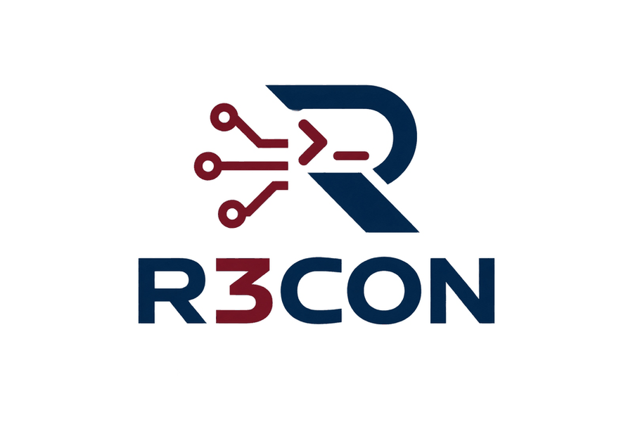

B
<p align="center">
  
</p>
<details>
<summary><h2><b> 💡Idea Proyecto </b></h2></summary>

# 🛡️ R3CON

### Análisis continuo de seguridad para pymes

SecureReport es un proyecto de plataforma que transforma el análisis técnico de una infraestructura en **hallazgos comprensibles, informes periódicos y alertas accionables**.

La propuesta consiste en desplegar dos contenedores Podman en un entorno autorizado por el cliente. Estos identifican activos y servicios, realizan comprobaciones de seguridad y envían los resultados a una plataforma central. El cliente puede consultar la evolución de su infraestructura desde un portal privado, descargar informes PDF y recibir avisos relevantes por Telegram.

> **Estado del proyecto:** fase de diseño. La arquitectura, las funcionalidades y los precios descritos son propuestas pendientes de implementación y validación.

## 🎯 Objetivo

Ayudar a pymes y startups sin un equipo especializado de ciberseguridad a responder tres preguntas:

- ¿Qué dispositivos y servicios tenemos en nuestra infraestructura?
- ¿Qué posibles riesgos se han detectado y con qué grado de confianza?
- ¿Qué deberíamos corregir primero?

SecureReport se plantea como un servicio de **análisis continuo de exposición y vulnerabilidades**. No sustituye una auditoría manual completa, un pentest profesional ni una certificación de cumplimiento.

## 🧭 Funcionamiento previsto

1. **Alta del cliente:** la organización accede al portal y define los activos, redes, interfaces y horarios autorizados.
2. **Despliegue de agentes:** instala dos contenedores Podman con permisos ajustados a las funciones que realizará cada uno.
3. **Recopilación y análisis:** los agentes descubren servicios y ejecutan comprobaciones no destructivas dentro del alcance acordado.
4. **Procesamiento central:** la API recibe resultados estructurados; el backend los valida, correlaciona y prioriza.
5. **Entrega de resultados:** el cliente consulta el dashboard, recibe informes PDF y obtiene avisos por Telegram cuando corresponde.
6. **Seguimiento:** el portal permite revisar hallazgos, registrar avances y comunicarse con el equipo.

## 🏗️ Arquitectura propuesta

```text
                 INFRAESTRUCTURA DEL CLIENTE
           ┌──────────────────────────────────────┐
           │ Contenedor 1: red y tráfico           │
           │ Nmap · TShark / dumpcap               │
           ├──────────────────────────────────────┤
           │ Contenedor 2: análisis de seguridad   │
           │ Comprobaciones · evidencia · hallazgos│
           └──────────────────┬───────────────────┘
                              │
                      Comunicación protegida
                              │
                              ▼
                  ┌─────────────────────────┐
                  │ API central · FastAPI   │
                  └────────────┬────────────┘
                               │
                     PostgreSQL + workers
                               │
                ┌──────────────┼──────────────┐
                ▼              ▼              ▼
          Portal privado   Informes PDF    n8n + Telegram
          y mensajería     e histórico     y apoyo de IA
```

| Componente | Responsabilidad | Tecnologías propuestas |
|---|---|---|
| **Contenedor 1 · Sensor de red** | Descubrimiento de activos, puertos y servicios; obtención opcional de indicadores de tráfico. | Podman, Nmap, TShark/dumpcap |
| **Contenedor 2 · Analizador** | Comprobaciones de seguridad no destructivas y preparación de hallazgos con evidencia. | Podman, Python y módulos de análisis |
| **API y base de datos** | Recepción de resultados, autenticación, separación de clientes e histórico. | FastAPI, PostgreSQL |
| **Procesamiento** | Correlación, deduplicación, priorización y generación de informes. | Workers y generador de PDF |
| **Portal y comunicaciones** | Dashboard, informes, mensajería del cliente y notificaciones. | Web, correo, n8n y Telegram |

## 🔎 Agentes de análisis

### Contenedor 1: red y tráfico

El primer contenedor utilizará **Nmap** para descubrir equipos, puertos y servicios dentro de los rangos autorizados. De forma opcional, podrá emplear **TShark o dumpcap** para obtener información de tráfico en interfaces concretas.

La captura de tráfico no se activará por defecto. Su alcance dependerá de la ubicación del agente, los permisos disponibles y la autorización del cliente. Instalar el contenedor en un servidor **no implica poder observar toda la red**.

### Contenedor 2: análisis de seguridad

El segundo contenedor trabajará sobre los activos y servicios detectados para ejecutar comprobaciones adicionales de bajo impacto. Cada resultado deberá incluir:

- Activo y servicio afectados.
- Regla aplicada o referencia técnica.
- Evidencia que respalda el hallazgo.
- Severidad y grado de confianza.
- Recomendación de corrección.
- Estado de revisión o remediación.

Una versión de software detectada puede sugerir un posible CVE, pero **no confirma por sí sola que el sistema sea vulnerable**. Los resultados dudosos se marcarán como pendientes de verificación.

## 🤖 IA y automatización con n8n

La IA se plantea como una herramienta de **apoyo al análisis**, no como autoridad final. Podrá ayudar a agrupar hallazgos repetidos, resumir evidencias y redactar recomendaciones claras para el cliente. Los resultados importantes o inciertos deberán poder revisarse antes de presentarse como confirmados.

**n8n** coordinará procesos como la generación periódica de informes, las solicitudes de revisión y el envío de avisos. La lógica principal de seguridad, la autenticación y el control de permisos permanecerán en el backend.

```text
Nuevo hallazgo
    → Validación y deduplicación
    → Priorización
    → Revisión si existe incertidumbre
    → Publicación en el portal
    → Aviso por Telegram, si procede
    → Inclusión en el informe periódico
```

## 📊 Portal, mensajería e informes

El proyecto contempla dos espacios web diferenciados:

- **Web pública:** presentación de la empresa, explicación del servicio, planes y contacto.
- **Portal privado:** acceso del cliente al dashboard, inventario, hallazgos, informes y mensajería con el equipo.

El **informe PDF periódico** incluirá un resumen ejecutivo, cambios desde el informe anterior, hallazgos priorizados, evidencia técnica, recomendaciones y estado de remediación.

Telegram servirá como **canal de aviso**, no como repositorio de información sensible. Por ejemplo, una notificación podrá indicar que se ha detectado un hallazgo de prioridad alta y dirigir al cliente al portal autenticado para consultar los detalles.

## 🔐 Seguridad y límites

El sistema debe construirse aplicando el principio de **mínimo privilegio** tanto a los agentes como a la plataforma central.

- Escanear únicamente redes y activos con autorización expresa.
- Definir horarios, límites de velocidad y exclusiones antes de ejecutar pruebas.
- No montar `/var/run/docker.sock` ni usar `--network host` por defecto.
- Limitar la captura a interfaces y permisos específicamente autorizados.
- Enviar preferentemente resultados estructurados y metadatos mínimos, no capturas completas de paquetes.
- Proteger la comunicación, las credenciales de los agentes y la separación de datos entre clientes.
- Mantener trazabilidad de escaneos, cambios y accesos.
- Definir políticas de conservación y tratamiento de los datos obtenidos.

> **Importante:** SecureReport no debe presentarse como una garantía de ausencia de vulnerabilidades. Los escaneos automatizados tienen límites y pueden generar falsos positivos o no detectar determinados problemas.

## 🚀 Roadmap

| Fase | Objetivo | Entrega |
|---|---|---|
| **1 · Base técnica** | Demostrar el flujo completo en un laboratorio propio. | Nmap → API → PostgreSQL |
| **2 · Primer producto** | Hacer consultables los resultados. | Portal privado, inventario e informe PDF |
| **3 · Análisis** | Ampliar las comprobaciones sin perder calidad. | Segundo contenedor, evidencia, confianza y deduplicación |
| **4 · Comunicación** | Automatizar el seguimiento del cliente. | Telegram, mensajería web y flujos n8n |
| **5 · Validación** | Evaluar utilidad y seguridad reales. | IA supervisada y pilotos con organizaciones autorizadas |

## 💼 Modelo de negocio propuesto

| Plan | Precio orientativo | Enfoque |
|---|---:|---|
| **Starter** | 49 €/mes | Organizaciones pequeñas que necesitan inventario e informes periódicos. |
| **Business** | 99 €/mes | Mayor cobertura, seguimiento más frecuente y alertas. |
| **Enterprise / MSP** | Desde 299 €/mes | Varias sedes u organizaciones e integraciones acordadas. |

Estos precios son **hipótesis**, no tarifas definitivas. Antes de comercializar el servicio será necesario validar la demanda, el coste de operación y soporte, los límites de cada plan y la calidad de los hallazgos.

## 📌 Estado actual

SecureReport se encuentra en **fase de definición**. El siguiente hito técnico es construir un laboratorio controlado y demostrar el recorrido completo:

```text
Escaneo autorizado → API → almacenamiento → hallazgo → informe
```

La prioridad inicial es obtener resultados fiables y explicables antes de añadir más herramientas o prometer una auditoría completa.
</details>


<details>
<summary><h2><b> 📅 Planificacion del proyecto </b></h2></summary>

# 🛡️ R3con — Planificación técnica del proyecto

> **R3con** es un prototipo funcional de reconocimiento y análisis continuo de seguridad para infraestructuras autorizadas. El proyecto se desarrolla como Trabajo Final de Ciclo de **ASIX, perfil de ciberseguridad**, por Raúl, Ricard y Jam.

**Estado:** fase de planificación y diseño de arquitectura.  
**Idioma:** español.  
**Entorno de demostración:** laboratorio aislado en VirtualBox/Proxmox.  
**Fecha objetivo de finalización:** antes de abril.

---

## 🎯 1. Objetivo del proyecto

R3con tiene como objetivo demostrar, en un laboratorio controlado, cómo una plataforma web puede:

- Descubrir equipos, puertos y servicios de una red autorizada mediante **Nmap**.
- Analizar indicadores y metadatos de red utilizando **TShark/Wireshark**, sin almacenar capturas PCAP completas.
- Detectar configuraciones o servicios que requieran revisión mediante reglas no destructivas.
- Centralizar resultados en una aplicación web con autenticación, roles y dashboard.
- Generar informes PDF automáticos diarios, semanales o bajo demanda.
- Enviar alertas críticas mediante un bot de Telegram.
- Automatizar tareas con **n8n**.
- Investigar e integrar **MicroCloud** como parte de la innovación y el aprendizaje de infraestructura privada.

> R3con no será una herramienta de explotación, ni realizará ataques contra redes externas. Todas las pruebas se limitarán a máquinas virtuales propias y a rangos de red explícitamente autorizados.

---

## ✅ 2. Alcance del MVP

### Funcionalidades obligatorias

| Funcionalidad | Descripción |
|---|---|
| Descubrimiento de red | Identificación de hosts, puertos y servicios con Nmap dentro de un CIDR autorizado |
| Análisis de tráfico | Obtención de metadatos y protocolos con TShark/dumpcap en el laboratorio |
| Reglas de seguridad | Detección de configuraciones o servicios que requieran revisión |
| Agentes Podman | Dos contenedores separados: sensor y analizador |
| Aplicación web | Login real, roles, dashboard, activos, hallazgos e informes |
| Base de datos | Persistencia de usuarios, escaneos, activos, hallazgos e informes en MariaDB/MySQL |
| PDF | Generación real de informes periódicos y bajo demanda |
| Telegram | Bot con alertas críticas y resumen de estado |
| MicroCloud | Prueba docente de despliegue y documentación de su integración |

### Mejoras futuras

- Asistente de IA dentro del portal.
- Explicaciones automáticas de hallazgos para usuarios no técnicos.
- Clasificación avanzada de riesgos mediante IA.
- Chat de soporte integrado.
- Integración con correo electrónico.
- MFA para usuarios administrativos.
- Más reglas y módulos de análisis.

---

## 🏗️ 3. Arquitectura general

```text
                           LABORATORIO R3CON
┌──────────────────────────────────────────────────────────────────────┐
│                      Red interna VirtualBox                          │
│                                                                      │
│  ┌───────────────────┐       ┌───────────────────────────────────┐  │
│  │ VM objetivo 1     │       │ VM objetivo 2                     │  │
│  │ Debian / Ubuntu   │       │ Kali / Ubuntu de práctica         │  │
│  │ SSH · HTTP · DNS  │       │ Servicios de laboratorio          │  │
│  └─────────▲─────────┘       └──────────────▲────────────────────┘  │
│            │                                │                       │
│            └─────────── Escaneo autorizado ─┘                       │
│                                                                      │
│  ┌──────────────────────────────────────────────────────────────┐  │
│  │ VM R3con Agent                                                 │  │
│  │ Ubuntu Server + Podman                                         │  │
│  │                                                               │  │
│  │ ┌──────────────────────┐  ┌────────────────────────────────┐ │  │
│  │ │ r3con-sensor         │  │ r3con-analyzer                 │ │  │
│  │ │ Nmap                 │  │ TShark + reglas seguras        │ │  │
│  │ │ Hosts/puertos/serv.  │  │ Hallazgos JSON                 │ │  │
│  │ └──────────┬───────────┘  └──────────────┬─────────────────┘ │  │
│  └────────────┼─────────────────────────────┼───────────────────┘  │
└───────────────┼─────────────────────────────┼──────────────────────┘
                └───────────────┬─────────────┘
                                HTTPS
                                  │
                                  ▼
┌──────────────────────────────────────────────────────────────────────┐
│                          R3CON CORE                                  │
│                    Ubuntu Server / MicroCloud                        │
│                                                                      │
│ FastAPI ── MariaDB ── Worker ── PDF ── n8n ── Telegram              │
│      │                                                               │
│      ├── Dashboard web HTML/CSS/JavaScript                           │
│      ├── Login y control de roles                                    │
│      ├── Histórico de escaneos e informes                            │
│      └── Alertas críticas y resumen periódico                        │
└──────────────────────────────────────────────────────────────────────┘
```

### Flujo principal

```text
Política de alcance autorizada
        ↓
R3con Sensor y R3con Analyzer
        ↓
Resultados JSON estructurados
        ↓
API FastAPI mediante HTTPS
        ↓
MariaDB + procesamiento asíncrono
        ↓
Hallazgos priorizados, dashboard e informes PDF
        ↓
Alertas críticas por Telegram y automatizaciones n8n
```

---

## 🧩 4. Componentes principales

| Componente | Responsabilidad | Tecnologías propuestas |
|---|---|---|
| `r3con-sensor` | Descubre hosts, puertos y servicios en los rangos permitidos | Podman, Python, Nmap |
| `r3con-analyzer` | Ejecuta comprobaciones no destructivas, procesa metadatos de tráfico y crea hallazgos | Podman, Python, TShark/dumpcap, reglas YAML/JSON |
| R3con Core | Recibe resultados, valida datos, centraliza lógica y expone API | Python, FastAPI, Pydantic |
| Base de datos | Guarda clientes, usuarios, políticas, activos, escaneos y hallazgos | MariaDB/MySQL |
| Worker | Deduplica, prioriza, genera PDF y activa alertas | Python, tareas asíncronas |
| R3con Console | Portal con login, dashboard, informes y estado de remediación | HTML, CSS, JavaScript |
| Automatización | Programa procesos, notificaciones y flujos de soporte | n8n |
| Bot R3con Notify | Envía avisos críticos y resúmenes al grupo o usuario autorizado | Telegram Bot API |
| MicroCloud | Laboratorio de nube privada y orquestación de instancias | MicroCloud, LXD, MicroOVN, MicroCeph opcional |

---

## 🖥️ 5. Infraestructura del laboratorio

Se utilizará una red aislada de VirtualBox. Las máquinas objetivo no estarán conectadas a una red puente doméstica o del centro, evitando análisis fuera del laboratorio.

| Máquina virtual | Sistema operativo | CPU | RAM | Disco | Función |
|---|---|---:|---:|---:|---|
| `r3con-core` | Ubuntu Server 24.04 LTS | 2 vCPU | 4 GB | 40 GB | API, MariaDB, dashboard, worker, PDF y n8n |
| `r3con-agent` | Ubuntu Server 24.04 LTS | 2 vCPU | 2 GB | 25 GB | Podman, sensor y analizador |
| `target-web` | Ubuntu Server o Debian | 1–2 vCPU | 2 GB | 20 GB | HTTP/HTTPS, SSH y servicios de prueba |
| `target-services` | Debian, Ubuntu o Kali | 1–2 vCPU | 2 GB | 20 GB | DNS, SSH u otros servicios de laboratorio |

### Diseño de red

```text
Red NAT
└── Uso exclusivo de r3con-core:
    - Actualizaciones de software.
    - Comunicación con Telegram.
    - Uso opcional de una API de IA.

Red interna: r3con-lab
├── r3con-core
├── r3con-agent
├── target-web
└── target-services
```

> Si el equipo anfitrión no dispone de suficiente RAM, se reducirán temporalmente las VMs objetivo a 1 GB, o se levantarán únicamente las máquinas necesarias para cada prueba.

---

## ☁️ 6. Integración de MicroCloud

MicroCloud se incluirá como innovación técnica y entorno de aprendizaje, sin bloquear el funcionamiento del MVP.

### Fase A: MVP sin dependencia de MicroCloud

El sistema funcionará inicialmente con las VMs descritas anteriormente. Esta fase permite completar el flujo de valor antes de añadir complejidad adicional:

```text
Nmap → JSON → API → MariaDB → Dashboard → PDF → Telegram
```

### Fase B: demostración de MicroCloud

Se desplegará MicroCloud en una VM o en un grupo de VMs Ubuntu para probar la creación y gestión de instancias LXD. La plataforma R3con Core podrá desplegarse en una instancia separada.

```text
MicroCloud de laboratorio
│
├── Instancia LXD: r3con-core
│   ├── FastAPI
│   ├── MariaDB
│   ├── n8n
│   └── Portal R3con
│
├── Instancia LXD: r3con-monitoring
│   └── Logs, copias o pruebas de monitorización
│
└── Red virtual gestionada
    └── Aislamiento de servicios del laboratorio
```

Para un proyecto académico se puede usar un único nodo con fines de prueba. No se describirá como alta disponibilidad. Un clúster con tolerancia a fallos requiere más nodos y una configuración adicional de almacenamiento distribuido.

---

## 🐳 7. Agentes Podman

### Contenedor 1: `r3con-sensor`

**Responsabilidad:** descubrimiento de red dentro del alcance permitido.

Funciones:

- Ejecutar perfiles Nmap seguros sobre CIDR autorizados.
- Detectar hosts activos, puertos y servicios.
- Registrar versiones observables cuando estén disponibles.
- Convertir resultados de Nmap a JSON normalizado.
- Enviar resultados a la API mediante HTTPS.
- Ejecutarse manualmente o mediante programación diaria/semanal.

### Contenedor 2: `r3con-analyzer`

**Responsabilidad:** interpretar resultados y generar hallazgos técnicos.

Funciones:

- Consumir resultados normalizados del sensor.
- Aplicar reglas no destructivas para identificar riesgos potenciales.
- Usar TShark/dumpcap para generar metadatos de red cuando el laboratorio lo permita.
- Detectar ejemplos como SSH expuesto, Telnet habilitado, HTTP sin HTTPS, certificados próximos a caducar o servicios que requieren revisión.
- Crear resultados JSON con activo, evidencia, severidad, confianza y recomendación.

> No se almacenarán ficheros PCAP completos. Solo se conservarán metadatos y resultados necesarios para demostrar el análisis.

---

## 🔐 8. Control de alcance y seguridad

El sistema no permitirá introducir libremente comandos Nmap desde el dashboard. Cada agente ejecutará únicamente políticas de escaneo previamente configuradas.

Ejemplo de política:

```json
{
  "policy_id": "lab-policy-01",
  "allowed_cidrs": ["10.10.10.0/24"],
  "allowed_ports": "1-1024",
  "scan_profile": "safe",
  "max_hosts": 20,
  "excluded_hosts": ["10.10.10.1"],
  "schedule": "daily"
}
```

Antes de iniciar un análisis, el agente deberá:

1. Validar que el destino pertenece a un rango de red privado autorizado.
2. Comprobar que el CIDR coincide con la política recibida.
3. Rechazar direcciones IP públicas, dominios y argumentos arbitrarios.
4. Aplicar límites de hosts, puertos, velocidad y tiempo de ejecución.
5. Registrar toda ejecución y resultado.
6. Utilizar perfiles de escaneo predefinidos, como `safe`, en lugar de aceptar parámetros libres.

Medidas adicionales:

- Autenticación real con contraseñas hasheadas mediante Argon2id o bcrypt.
- JWT con caducidad y control de roles.
- HTTPS entre agentes y API.
- Credenciales de agente revocables.
- Validación de JSON y límite de tamaño de carga.
- Registro de auditoría de accesos, cambios de estado y descargas de informes.
- Separación lógica de datos por organización.
- Variables de entorno para secretos; nunca guardar credenciales en GitHub.
- MFA planteado como mejora futura después del MVP.

---

## 👥 9. Roles de usuario

| Rol | Permisos |
|---|---|
| Administrador R3con | Gestiona organizaciones, usuarios, políticas, agentes, reglas y auditoría global |
| Administrador cliente | Gestiona usuarios de su organización, consulta activos, informes y hallazgos; puede cambiar estados |
| Técnico cliente | Consulta activos y hallazgos de su organización; añade comentarios y marca estado, sin gestionar usuarios ni alcance |

### Estados de un hallazgo

```text
nuevo → revisado → resuelto
               └→ aceptado
```

- **Nuevo:** hallazgo recién detectado.
- **Revisado:** un usuario ha confirmado que conoce el hallazgo.
- **Resuelto:** se ha aplicado una corrección y se puede verificar posteriormente.
- **Aceptado:** el cliente acepta temporalmente el riesgo con una justificación.

---

## 🗄️ 10. Datos almacenados en la demostración

Durante la demo se almacenarán exclusivamente datos generados en el laboratorio:

- Direcciones IP privadas de las máquinas virtuales.
- Nombres de host y servicios instalados en las VMs de prueba.
- Puertos, protocolos y versiones detectadas.
- Resultados normalizados de Nmap.
- Metadatos de tráfico obtenidos con TShark.
- Hallazgos derivados de reglas internas.
- Usuarios de prueba y sus roles.
- Registros de acceso y acciones administrativas.
- Mensajes internos de soporte.
- Informes PDF generados.

No se almacenarán contraseñas reales, información de terceros, datos procedentes de Internet ni capturas PCAP completas.

---

## 🧠 11. Backend, frontend y lógica de negocio

### Stack tecnológico

| Capa | Tecnología | Uso |
|---|---|---|
| Backend | Python + FastAPI | API REST, autenticación, validación y lógica de negocio |
| Agentes | Python + Bash | Ejecución y normalización de Nmap/TShark |
| Frontend | HTML + CSS + JavaScript | Login, dashboard, tablas y vistas de informes |
| Base de datos | MariaDB/MySQL | Persistencia de usuarios, activos, hallazgos y PDFs |
| Informes | ReportLab o WeasyPrint | Generación de PDF |
| Automatización | n8n | Flujos, programación, soporte y notificaciones |
| Alertas | Telegram Bot API | Avisos críticos y resúmenes |
| Contenedores | Podman | Separación y despliegue de agentes |
| Infraestructura | VirtualBox, Proxmox y MicroCloud | Laboratorio y pruebas de nube privada |

### Flujo de negocio

```text
1. El administrador R3con crea la organización y usuarios de prueba.
2. Se define una política de alcance para el laboratorio.
3. Se registra el agente y se le asigna una identidad.
4. El agente ejecuta Nmap y comprobaciones permitidas.
5. Los resultados se normalizan y se envían mediante HTTPS.
6. FastAPI valida los datos y los guarda en MariaDB.
7. El worker deduplica y prioriza hallazgos.
8. El dashboard muestra activos, hallazgos y estados.
9. El sistema genera informes PDF periódicos o bajo demanda.
10. Si existe un hallazgo crítico, el bot de Telegram envía una alerta.
```

### Priorización de riesgos

La prioridad no dependerá únicamente de una severidad técnica. Se utilizará una puntuación interna orientativa:

\[
Riesgo = Severidad \times Exposición \times Criticidad\ del\ activo \times Confianza
\]

| Factor | Valores iniciales |
|---|---|
| Severidad | Bajo, medio, alto, crítico |
| Exposición | Interno, accesible desde varias redes, expuesto en el laboratorio |
| Criticidad del activo | Laboratorio, servidor interno, servicio relevante |
| Confianza | Indicio, probable, verificado |

---

## 📦 12. Modelo de datos inicial

```text
organizations
├── users
├── agents
├── scan_policies
├── assets
│   ├── services
│   └── findings
├── scans
├── reports
├── notifications
├── support_messages
└── audit_logs
```

| Entidad | Información principal |
|---|---|
| `organizations` | Nombre, plan de demostración, estado y fecha de alta |
| `users` | Organización, email, hash de contraseña, rol y estado |
| `agents` | Organización, versión, estado, última conexión y credencial |
| `scan_policies` | CIDR permitido, horarios, perfiles, exclusiones y límites |
| `assets` | IP, hostname, tipo, criticidad y exposición |
| `services` | Activo, puerto, protocolo, producto y versión observada |
| `scans` | Agente, política, fechas, estado y errores |
| `findings` | Activo, regla, severidad, evidencia, confianza y estado |
| `reports` | Organización, periodo, archivo, hash y fecha de generación |
| `notifications` | Hallazgo, canal, destinatario y resultado de entrega |
| `support_messages` | Organización, autor, mensaje y estado |
| `audit_logs` | Actor, acción, recurso, fecha y resultado |

---

## 📡 13. Endpoints mínimos de la API

| Método | Ruta | Función |
|---|---|---|
| `POST` | `/api/v1/auth/login` | Inicio de sesión |
| `POST` | `/api/v1/auth/refresh` | Renovación controlada de sesión |
| `GET` | `/api/v1/dashboard` | Resumen de la organización autenticada |
| `GET` | `/api/v1/assets` | Activos detectados |
| `GET` | `/api/v1/findings` | Hallazgos filtrables |
| `PATCH` | `/api/v1/findings/{id}` | Cambiar estado o añadir gestión del hallazgo |
| `GET` | `/api/v1/reports` | Histórico de informes |
| `GET` | `/api/v1/reports/{id}/download` | Descarga protegida de PDF |
| `POST` | `/api/v1/agents/enroll` | Registro controlado de agente |
| `POST` | `/api/v1/agents/{id}/results` | Envío de resultados JSON |
| `POST` | `/api/v1/agents/{id}/heartbeat` | Estado y última conexión del agente |
| `POST` | `/api/v1/messages` | Mensajería de soporte |

---

## 🤖 14. Automatización, Telegram e IA

### Automatización con n8n

n8n tendrá un papel de apoyo, no reemplazará el backend:

- Programar informes diarios o semanales.
- Recibir eventos o webhooks del backend.
- Activar envío de alertas Telegram.
- Crear flujos de recordatorio de hallazgos pendientes.
- Conectar con un futuro asistente IA.
- Automatizar respuestas básicas de soporte, siempre con control humano.

### Alertas Telegram

El bot enviará:

- Alertas de hallazgos críticos.
- Avisos de agente desconectado.
- Resumen diario o semanal.
- Enlace al portal web autenticado.

No enviará datos técnicos sensibles completos ni credenciales dentro de Telegram.

### IA como mejora futura

La IA se añadirá solo después de completar el MVP. Las posibles funciones son:

- Explicar recomendaciones técnicas para usuarios no especializados.
- Resumir hallazgos de un informe.
- Clasificar propuestas de prioridad con revisión humana.
- Asistente de soporte dentro del portal.
- Analizar logs de forma asistida.

La IA no podrá ejecutar escaneos, modificar políticas ni confirmar automáticamente una vulnerabilidad.

---

## 👨‍💻 15. Reparto de tareas

| Integrante | Responsabilidad principal | Entregables previstos |
|---|---|---|
| **Raúl** | Sistemas, redes y documentación técnica | VMs, red VirtualBox/Proxmox, Podman, Nmap, TShark, despliegue, pruebas, diagramas y manual técnico |
| **Ricard** | Backend, base de datos y supervisión documental | FastAPI, MariaDB, API, autenticación, modelo de datos, PDF y revisión de memoria |
| **Jam** | Frontend, diseño y documentación visual | Login, dashboard, vistas de hallazgos e informes, manual de usuario y apoyo transversal |
| **Equipo completo** | Integración, automatización y defensa | Telegram, n8n, pruebas, evidencias, memoria, presentación y demostración final |

---

## 🗓️ 16. Plan de trabajo

| Fase | Objetivo | Resultado esperado |
|---|---|---|
| 1. Laboratorio | Crear VMs, red aislada y repositorio | Topología funcional y documentación de IPs |
| 2. Sensor | Implementar Nmap y JSON | Descubrimiento real de objetivos del laboratorio |
| 3. Backend | API, MariaDB, login y roles | Resultados almacenados y accesibles por API |
| 4. Dashboard | Portal, activos, hallazgos y estados | Aplicación web funcional |
| 5. Informes | PDF automático y descarga protegida | Informe real basado en datos del laboratorio |
| 6. Alertas | Telegram y n8n | Aviso crítico y resumen periódico |
| 7. MicroCloud | Prueba docente e integración opcional | Evidencia de nube privada/LXD documentada |
| 8. Mejoras | IA, MFA o funciones extra si hay tiempo | Funcionalidades opcionales sin afectar el MVP |
| 9. Entrega | Memoria, presentación y demo | Proyecto defendible y reproducible |

---

## 📌 17. Criterios de éxito

El prototipo se considerará funcional si permite demostrar de extremo a extremo:

```text
Red de laboratorio autorizada
        ↓
Escaneo Nmap desde R3con Sensor
        ↓
Resultados enviados a FastAPI
        ↓
Datos almacenados en MariaDB
        ↓
Hallazgo visible en el dashboard
        ↓
Informe PDF generado
        ↓
Alerta crítica recibida en Telegram
```

La prioridad será entregar este flujo de forma estable, documentada y reproducible antes de añadir IA, MFA, nuevas herramientas o características complejas.

---

## ⚠️ Nota sobre seguridad y ética

Todas las herramientas se usarán exclusivamente contra máquinas virtuales propias y redes creadas para el laboratorio. Cada exploración estará limitada mediante una política de alcance para impedir objetivos externos, argumentos arbitrarios o redes no autorizadas.
</details>

<details>
<summary><h2><b> 📌 Planificación de arquitectura </b></h2></summary>
# 🛡️ R3con — Planificación de arquitectura

> Trabajo Final de Ciclo de ASIX, perfil de ciberseguridad.  
> Documento preliminar de arquitectura y planificación para la actividad M0379 / Proyecto.

| Dato | Información |
|---|---|
| Proyecto | R3con |
| Integrantes | Raúl Ortiz, Ricard Forero y Jam Arango |
| Ciclo | ASIX, perfil de ciberseguridad |
| Módulo | M0379 / Proyecto |
| Fecha del documento | 15 de octubre de 2026 |
| Entrega de esta actividad | 22 de octubre de 2026 |
| Idioma | Español |
| Estado | Planificación preliminar |
| Formato de entrega | URL a la documentación compartida en GitHub |

> ⚠️ Este documento recoge las decisiones del equipo y una propuesta de despliegue. Quedan pendientes la ubicación definitiva de Proxmox, los recursos físicos disponibles, las versiones instaladas, el direccionamiento final y las evidencias de funcionamiento.

---

## 🎯 1. Objetivo del proyecto

R3con es un prototipo funcional de reconocimiento y análisis continuo de seguridad para infraestructuras autorizadas.

Su finalidad es integrar conocimientos de administración de sistemas, redes, desarrollo web, bases de datos y ciberseguridad mediante un laboratorio controlado.

Las funcionalidades previstas son:

- Descubrir equipos, puertos y servicios con Nmap.
- Obtener indicadores y metadatos de tráfico con TShark/Wireshark.
- Detectar configuraciones que requieran revisión mediante reglas no destructivas.
- Centralizar los resultados en una aplicación web con autenticación y roles.
- Consultar activos, hallazgos e informes desde un dashboard.
- Generar informes PDF periódicos.
- Enviar alertas críticas mediante Telegram.
- Automatizar procesos mediante n8n.
- Incorporar MicroCloud como parte de la entrega final del proyecto.

No se almacenarán capturas PCAP completas ni se analizarán redes externas.

> R3con complementa el análisis técnico de una infraestructura. No se presenta como una herramienta de explotación ni como sustituto de una auditoría manual completa.

---

## ✅ 2. Decisiones confirmadas

| Área | Decisión |
|---|---|
| Backend | Python + FastAPI |
| Frontend | HTML, CSS y JavaScript |
| Base de datos | MariaDB como tecnología propuesta |
| Usuarios | Creados por el administrador, sin registro público |
| Autenticación | Login real con contraseñas hasheadas y control de roles |
| Informes | PDF reales generados por el sistema |
| Alertas | Bot de Telegram |
| Automatización | n8n como apoyo al backend |
| Contenedores | Podman |
| Documentación | GitHub colaborativo |
| Idioma | Español |
| IA | Ampliación posterior al funcionamiento del MVP |
| MicroCloud | Debe funcionar para la entrega final; no es el objetivo inmediato de la actividad del 22 de octubre |
| Disponibilidad | Entre 5 y 10 horas semanales indicadas por el equipo; pendiente concretar si son por persona o para el grupo |

### Estado declarado del laboratorio

El equipo confirma que las siguientes máquinas están creadas y configuradas:

- `r3con-core`
- `r3con-agent`
- `target-web`

Las direcciones IP, versiones instaladas y pruebas de conectividad se incorporarán a la documentación cuando se registren sus valores reales.

---

## 🖥️ 3. Aclaración sobre VirtualBox y Proxmox

Es necesario concretar dónde se ejecutarán las máquinas de la entrega.

Proxmox VE administra las máquinas virtuales y contenedores alojados en su propia infraestructura. No funciona como un panel de administración directa de máquinas que continúan ejecutándose en VirtualBox.

| Caso | Entorno | Implicación |
|---|---|---|
| A | Proxmox instalado en otro equipo físico | Las VMs de la entrega se ejecutarán en ese servidor. VirtualBox quedará como laboratorio previo. |
| B | Proxmox instalado dentro de una VM de VirtualBox | Las VMs se crearán dentro de Proxmox; habrá que verificar compatibilidad y recursos para virtualización anidada. |
| C | Proxmox separado, pero las VMs siguen ejecutándose en VirtualBox | Será necesario revisar el diseño, porque esas VMs no estarán gestionadas directamente por Proxmox. |

> No se eliminarán las máquinas actuales hasta confirmar el entorno definitivo y decidir cómo aprovechar el trabajo realizado.

---

## 🏗️ 4. Distribución propuesta de máquinas

La actividad exige cuatro máquinas virtuales servidor separadas y una máquina cliente adicional.

Para integrar las funciones de R3con se conservarán, además, el agente de análisis y el objetivo de pruebas.

| Máquina | Función | Acción prevista |
|---|---|---|
| `r3con-web` | Servidor web, frontend y API FastAPI | Reutilizar la función de `r3con-core` y separar la base de datos si estuviera alojada allí |
| `r3con-db` | Base de datos MariaDB | Crear una VM dedicada |
| `r3con-net` | DNS y DHCP | Crear una VM dedicada |
| `r3con-backup` | Copias de seguridad y pruebas de restauración | Crear una VM dedicada |
| `r3con-client` | Cliente con navegador e IP asignada por DHCP | Crear una VM cliente |
| `r3con-agent` | Agentes Podman y herramientas de análisis | Conservar la VM existente |
| `target-web` | Objetivo autorizado para los análisis | Conservar la VM existente |

### Gateway

El gateway deberá proporcionar el enrutamiento y reenvío de puertos que solicita la actividad.

Está pendiente confirmar si:

- Lo proporciona el centro.
- Se puede configurar en la infraestructura disponible.
- Debe implementarse como una máquina virtual adicional.

---

## 🌐 5. Arquitectura lógica propuesta

El siguiente esquema representa funciones y relaciones entre componentes. No es todavía la topología de red definitiva.

```text
Ordenador físico de demostración
              │
      Acceso por dominio
              │
              ▼
Gateway / reenvío de puertos
              │
              ▼
        r3con-web
   ┌─────────────────────┐
   │ Servidor web        │
   │ Frontend            │
   │ API FastAPI         │
   └──────────┬──────────┘
              │
              ▼
         r3con-db
   ┌─────────────────────┐
   │ MariaDB             │
   │ Usuarios y roles    │
   │ Activos y hallazgos │
   │ Histórico           │
   └─────────────────────┘

Servicios de infraestructura
├── r3con-net
│   ├── DNS
│   └── DHCP
├── r3con-backup
│   └── Copias y restauración
└── r3con-client
    └── Navegador e IP por DHCP

Laboratorio de análisis R3con
├── r3con-agent
│   ├── Contenedor sensor
│   └── Contenedor analizador
└── target-web
    └── Servicios de prueba autorizados
```

El diagrama definitivo deberá incluir:

- Equipo físico e hipervisor.
- Máquinas virtuales.
- Interfaces de red.
- Subredes.
- Direcciones IP.
- Gateway.
- Reenvío de puertos.
- Resolución DNS.
- Separación entre elementos físicos y virtuales.

---

## 🧩 6. Componentes de software

Estas tecnologías son decisiones propuestas. Las versiones exactas se anotarán después de comprobar las instalaciones.

| Componente | Tecnología propuesta | Uso |
|---|---|---|
| Sistema operativo de servidores | Ubuntu Server | Alojamiento de servicios y aplicación |
| Servidor web | Nginx | Publicación del frontend y acceso a la API |
| Backend | Python + FastAPI | Autenticación, lógica de negocio y API |
| Frontend | HTML, CSS y JavaScript | Portal de usuario y dashboard |
| Base de datos | MariaDB | Persistencia de usuarios y resultados |
| Contenedores | Podman | Ejecución de agentes |
| Descubrimiento | Nmap | Identificación de equipos y servicios |
| Análisis de tráfico | TShark/dumpcap | Obtención de metadatos autorizados |
| Automatización | n8n | Flujos y notificaciones |
| Alertas | Telegram Bot API | Avisos críticos y resúmenes |
| Nube privada | MicroCloud | Integración para la entrega final |

### Datos pendientes para completar la tabla tecnológica

Para cada servicio se documentará:

- Versión instalada.
- Puerto de funcionamiento.
- Interfaz o dirección donde escucha.
- Dominio, si procede.
- Justificación de uso.
- Enlace a documentación oficial.

---

## 👥 7. Roles previstos

| Rol | Funciones |
|---|---|
| Administrador R3con | Gestiona organizaciones, usuarios, agentes, políticas y configuración global |
| Administrador cliente | Gestiona usuarios de su organización y consulta activos, hallazgos e informes |
| Técnico cliente | Consulta resultados, añade comentarios y actualiza estados de hallazgos |

La aplicación deberá comprobar tanto el rol como la organización del usuario antes de permitir acceso a datos o acciones.

---

## 🔐 8. Seguridad de la infraestructura

### Firewall y mínimo privilegio

- La base de datos solo aceptará conexiones de aplicación desde el servidor web/backend autorizado.
- Las excepciones administrativas o de copias deberán justificarse y limitarse.
- Solo se permitirán los puertos necesarios para cada servicio.
- No se expondrá la base de datos directamente a la red real.
- Se documentarán las reglas del firewall y sus pruebas.

### Administración segura

- Acceso SSH mediante claves.
- Credenciales fuera del repositorio.
- Archivos de ejemplo sin secretos reales.
- Usuarios de base de datos con permisos limitados.
- Consultas parametrizadas para prevenir inyección SQL.
- Registro de operaciones relevantes.

### Análisis autorizado

- Rangos de escaneo definidos expresamente.
- Sin argumentos de comandos libres introducidos desde la web.
- Perfiles de análisis controlados.
- Límites de tiempo y velocidad.
- Sin escaneos de redes externas.
- Sin almacenamiento de PCAP completos.

---

## 💾 9. Copias de seguridad

La máquina `r3con-backup` se utilizará para almacenar las copias previstas del proyecto.

El procedimiento deberá documentar:

1. Qué información se copia.
2. Desde qué servidor se obtiene.
3. Cómo se ejecuta la copia.
4. Dónde se almacena.
5. Qué permisos protegen los archivos.
6. Cuánto tiempo se conservan.
7. Cómo se restaura una copia.

> Una copia no se considerará validada únicamente por existir el archivo: deberá realizarse una restauración de prueba y registrar el resultado.

---

## 🧪 10. Hito de evaluación del 22 de octubre

La primera demostración consistirá en publicar una web de prueba sobre la infraestructura diseñada.

### Resultado objetivo

```text
Ordenador físico de clase
        ↓
Resolución del dominio personalizado
        ↓
Gateway y reenvío de puertos
        ↓
Servidor web
        ↓
Página de prueba R3con
```

También se comprobará el acceso desde la VM cliente, que deberá obtener su configuración de red mediante DHCP.

Para esta fase no es necesario presentar todo el dashboard terminado. La prioridad es demostrar la infraestructura cliente-servidor y el acceso por dominio.

### Evidencias que se deben recoger

- Máquinas virtuales creadas.
- Configuración de interfaces y direcciones.
- Cliente obteniendo configuración por DHCP.
- Resolución del dominio mediante el DNS del laboratorio.
- Página de prueba accesible desde la VM cliente.
- Página accesible por dominio desde una máquina física, si el entorno lo permite.
- Reenvío de puertos configurado.
- Conexión del backend con MariaDB.
- Restricción de acceso a la base de datos.
- Acceso SSH con claves.
- Copia y restauración de prueba.

---

## 🗓️ 11. Calendario propuesto

Las fechas siguientes son objetivos de trabajo, no evidencias de tareas realizadas.

| Fecha | Resultado esperado | Responsable principal |
|---|---|---|
| 16 de octubre | Confirmar Proxmox, hardware, inventario y topología | Raúl y equipo |
| 17–18 de octubre | Preparar VMs obligatorias y conectividad | Raúl |
| 18–19 de octubre | Configurar DNS, DHCP y web de prueba desde cliente virtual | Raúl y Jam |
| 19–20 de octubre | Separar MariaDB, probar backend y aplicar restricciones | Ricard |
| 20–21 de octubre | Probar copias, restauración, SSH con claves y acceso desde equipo físico | Equipo |
| 21 de octubre | Completar capturas, diagramas, documentación y ensayo | Equipo |
| 22 de octubre | Entregar URL y realizar la demostración acordada | Equipo |

### Trabajo en paralelo

- Ricard: modelo E-R, backend y revisión documental.
- Jam: mapa de navegación, wireframes y presentación de la web.
- Raúl: infraestructura, red y documentación técnica.
- Equipo: integración, pruebas y preparación de la defensa.

---

## 📚 12. Documentación pendiente de completar

### Matriz de requisitos

Se elaborará una tabla con los campos solicitados:

| ID | Prioridad | Objetivo | Funcionalidad | Disparador | Fecha de entrega | Estado |
|---|---|---|---|---|---|---|
| Por definir | Alta / Media / Baja | Necesidad a cubrir | Solución concreta | Acción o tarea que la inicia | Fecha prevista | Activo / Pendiente / Cancelado |

### Arquitectura tecnológica

Se documentarán tecnologías, versiones, puertos, dominios y justificación de cada elección.

### Base de datos

El diseño E-R incluirá:

- Tablas y campos.
- Tipos y límites de datos.
- Claves primarias y foráneas.
- Cardinalidades.
- Tablas intermedias para relaciones N:M cuando proceda.
- Restricciones necesarias para conservar la integridad.

### Interfaz

Se prepararán:

- Mapa de navegación.
- Wireframes.
- Roles y permisos.
- Descripción de los elementos principales de cada pantalla.

### Control de versiones

El repositorio GitHub contendrá:

- Código.
- Documentación.
- Diagramas.
- Evidencias seleccionadas.
- Manuales de instalación y pruebas.

No se incluirán contraseñas, tokens, claves privadas ni archivos `.env` con secretos.

---

## ❓ 13. Información pendiente de confirmar

| Punto | Información necesaria |
|---|---|
| Proxmox | Dónde está instalado y si ya se puede acceder a su interfaz |
| Hardware | Procesador, RAM y espacio SSD disponible del equipo que alojará las VMs |
| Dedicación | Si las 5–10 horas son por integrante o para el grupo |
| VMs actuales | Sistema, versión e IP de `r3con-core`, `r3con-agent` y `target-web` |
| Equipo de clase | Si se permite modificar su configuración DNS |
| Gateway | Si lo proporciona el centro o debe crearse |
| Reenvío de puertos | Quién puede configurar las reglas y en qué equipo |

---

## ☁️ 14. MicroCloud y ampliaciones

MicroCloud se implementará para la entrega final del proyecto, después de estabilizar la infraestructura básica.

No se condicionará el hito del 22 de octubre a su funcionamiento.

La IA también se incorporará como ampliación posterior, siempre que el flujo principal ya permita:

```text
Análisis autorizado
        ↓
Recepción de resultados
        ↓
Persistencia en base de datos
        ↓
Consulta desde el dashboard
        ↓
Informe PDF
        ↓
Alerta por Telegram
```

---

## 📌 15. Criterio de cierre de esta planificación

La planificación podrá considerarse cerrada cuando:

- [ ] Se confirme la infraestructura Proxmox.
- [ ] Se conozcan los recursos físicos disponibles.
- [ ] Se apruebe la distribución de VMs.
- [ ] Se complete el direccionamiento y dominio.
- [ ] Se documenten versiones y puertos.
- [ ] Se termine la matriz de requisitos.
- [ ] Se adjunte el modelo E-R.
- [ ] Se adjunten el mapa de navegación y los wireframes.
- [ ] Se registren las pruebas y evidencias de infraestructura.
- [ ] Se ensaye el acceso por dominio para la demostración.

---

## 📖 16. Base documental

- Enunciado: `A3-ArquitecturaSW.docx.pdf`, actividad de Arquitectura del Software, M0379 / Proyecto.
- [Guía de administración de Proxmox VE](https://pve.proxmox.com/pve-docs/pve-admin-guide.html).
- [Proxmox VE dentro de VirtualBox](https://pve.proxmox.com/wiki/Proxmox_VE_inside_VirtualBox).

---

> Documento preliminar elaborado a partir de las decisiones del equipo y de los requisitos de la actividad. Las propuestas no se presentarán como implementadas hasta disponer de pruebas y evidencias.
</details>


<details>
<summary><h2><b> 🎨 Diseño UX/UI y wireframes de R3con </b></h2></summary>

## 1. Introducción

Durante la fase de diseño de R3con se elaboraron wireframes de baja y alta fidelidad para definir la estructura, la distribución de los elementos y la navegación de la aplicación antes de su implementación.

El trabajo se dividió en dos espacios:

- Web corporativa pública: presentación de la empresa, servicios y contacto.
- Área personal del cliente: consulta del calendario, informes, hallazgos e historial.

También se diseñó la pantalla de acceso y se elaboró un mapa de navegabilidad.


> Los wireframes representan una propuesta de diseño. No implican que todas las funcionalidades estén implementadas o conectadas con el backend.

---

## 2. Objetivos del diseño

Los objetivos principales fueron:

- Definir la estructura visual de las pantallas.
- Organizar la información de forma clara.
- Diferenciar la web pública del área personal del cliente.
- Establecer los recorridos de navegación.
- Mantener una identidad visual coherente.
- Facilitar la posterior implementación de la interfaz.
- Revisar la distribución antes de desarrollar las funcionalidades.

La web pública se orientó a explicar la propuesta de R3con: reconocimiento de activos, visibilidad de servicios y análisis de la superficie de exposición en entornos autorizados.

---

## 3. Evolución del proceso de diseño

### 3.1. Referencia inicial

Se partió de una captura con esquemas visuales sencillos que mostraban la distribución de diferentes pantallas.

Esta referencia permitió identificar los elementos básicos:

- Cabecera.
- Logotipo.
- Menús de navegación.
- Bloques de contenido.
- Botones.
- Formularios.
- Tarjetas.
- Pie de página.

### 3.2. Definición de la web corporativa

Se concretó que la web pública debía presentar la empresa y sus servicios, sin confundirse con una consola técnica o un dashboard.

Se definieron las siguientes páginas:

1. Inicio.
2. Servicios.
3. Detalle de servicio.
4. Sobre nosotros.
5. Contacto.

Posteriormente se añadió la pantalla de Login.

### 3.3. Exploración visual

Durante las primeras iteraciones se exploraron diseños de escritorio y móvil, así como una dirección visual basada en azul marino oscuro y turquesa.

Después se ajustó el alcance:

- Solo formato PC.
- Colores granate y azul marino.
- Incorporación del logotipo de R3con.
- Menos texto definitivo y mayor protagonismo de la estructura visual.

Las versiones móviles y la paleta turquesa quedaron como propuestas exploratorias, no como la entrega final seleccionada.

### 3.4. Simplificación de la baja fidelidad

La baja fidelidad se simplificó a partir de una nueva referencia aportada.

Se eliminaron colores de marca, detalles decorativos y textos visibles de la web pública. La estructura pasó a representarse mediante cajas, líneas y óvalos.

### 3.5. Diseño del área personal del cliente

Una vez definida la web pública y el login, se incorporó un dashboard independiente para el cliente.

Se diseñaron cinco vistas:

- Resumen.
- Calendario.
- Informes.
- Hallazgos.
- Historial.

---

## 4. Wireframes de baja fidelidad

### 4.1. Finalidad

Los wireframes de baja fidelidad se utilizaron para representar el esqueleto de las pantallas.

Su objetivo fue revisar:

- La posición de los elementos.
- La distribución del espacio.
- La jerarquía de la información.
- La ubicación de los accesos principales.
- La relación entre los bloques.

### 4.2. Características

La versión final de baja fidelidad utiliza:

- Fondo claro.
- Líneas finas en gris.
- Rectángulos para contenedores, tarjetas, campos e imágenes.
- Líneas horizontales para representar texto.
- Óvalos o formas sencillas para los botones.
- Ausencia de sombras y decoración.
- Ausencia de colores corporativos.
- Marcadores de posición para el logotipo.

En las pantallas públicas se evitó el texto visible para mantener un esquema muy simple.

En el dashboard se conservaron los nombres del menú y los accesos de sección para facilitar la identificación de las vistas.

---

## 5. Wireframes de alta fidelidad

### 5.1. Finalidad

Los wireframes de alta fidelidad se elaboraron para mostrar una propuesta visual más cercana a la interfaz prevista.

Se definieron:

- Colores.
- Tipografía de referencia.
- Logotipo.
- Botones.
- Formularios.
- Tarjetas.
- Tablas.
- Estados visuales.
- Navegación activa.

No se incorporaron todos los textos definitivos de la web. En varios bloques se utilizaron líneas y marcadores para representar contenido pendiente.

### 5.2. Identidad visual

| Elemento | Valor de referencia |
| --- | --- |
| Azul marino | `#082A49` |
| Granate | `#7C1730` |
| Fondo claro | `#F3F5F8` |
| Tipografía | Inter, con Arial o sans-serif como alternativa |
| Estilo | Tecnológico, corporativo y sobrio |

El azul marino se utilizó en títulos y zonas estructurales.

El granate se aplicó a botones, acciones principales y elementos activos.

Las superficies claras ayudaron a separar los bloques de información.

### 5.3. Logotipo

Se incorporó el logotipo proporcionado para R3con.

En los SVG de alta fidelidad, el logo se incrustó como imagen para conservar su aspecto original.

> El logotipo incrustado no se vectorizó: sigue siendo una imagen dentro del archivo SVG.

---

## 6. Comparación entre baja y alta fidelidad

| Aspecto | Baja fidelidad | Alta fidelidad |
| --- | --- | --- |
| Objetivo | Revisar estructura y distribución | Representar la apariencia propuesta |
| Colores | Blanco y gris | Granate, azul marino y fondos claros |
| Texto | Líneas y marcadores | Etiquetas funcionales y contenido de ejemplo |
| Logotipo | Recuadro de posición | Logo de R3con |
| Botones | Formas simples | Botones con estilo corporativo |
| Componentes | Cajas y líneas | Tarjetas, tablas, campos y estados visuales |
| Navegación en SVG | Estática | Estática |

---

## 7. Pantallas de la web pública

### 7.1. Inicio

La página de Inicio reúne los accesos a la información principal de R3con.

La propuesta de alta fidelidad contempla:

- Cabecera con logotipo.
- Menú de navegación.
- Bloque principal de presentación.
- Botones de acceso a servicios y contacto.
- Propuesta de valor.
- Servicios destacados.
- Metodología.
- Ejemplo conceptual de informe.
- Presentación de la empresa.
- Preguntas frecuentes.
- Llamada a contacto.
- Pie de página.

La baja fidelidad final presenta una composición resumida de la estructura, sin reproducir todos los contenidos de la versión larga.

### 7.2. Servicios

La página de Servicios presenta cuatro áreas propuestas:

1. Reconocimiento de activos.
2. Identificación de servicios expuestos.
3. Análisis de superficie de exposición.
4. Informes y recomendaciones técnicas.

Cada servicio se representa mediante una tarjeta con acceso a su detalle.

> Los servicios y sus capacidades deben validarse con el equipo del proyecto antes de publicarse como oferta definitiva.

### 7.3. Detalle de servicio

Se diseñó una plantilla reutilizable para explicar cada servicio.

Sus bloques son:

- Qué es.
- Para quién está pensado.
- Qué incluye.
- Qué queda fuera del alcance.
- Cómo se desarrolla.
- Qué se entrega.
- Llamada a contacto.

La pantalla utilizada como referencia corresponde a Reconocimiento de activos.

Los otros servicios pueden reutilizar la distribución, pero necesitan contenido específico validado.

### 7.4. Sobre nosotros

Esta página presenta el enfoque de R3con.

La estructura contempla:

- Presentación de la empresa.
- Espacio para el logotipo o un recurso visual.
- Trabajo en entornos autorizados.
- Comunicación clara.
- Rigor técnico.
- Documentación comprensible.
- Acceso a Contacto.

No se añadieron clientes, certificaciones, integrantes del equipo ni cifras comerciales inventadas.

### 7.5. Contacto

La página de Contacto incluye una zona informativa y un formulario.

| Campo | Condición prevista |
| --- | --- |
| Nombre | Obligatorio |
| Empresa | Opcional |
| Correo electrónico | Obligatorio |
| Mensaje | Obligatorio |
| Aceptación de privacidad | Obligatoria y sin marcar inicialmente |

La acción principal es «Enviar consulta».

No se solicitan contraseñas, credenciales ni información técnica sensible en este formulario.

En el prototipo inicial de la web pública se exploraron:

- Validación de campos.
- Estado de envío.
- Error de envío.
- Confirmación simulada.

> El formulario del prototipo no envía ni almacena datos.

---

## 8. Pantalla de Login

Se diseñó una pantalla de acceso en baja y alta fidelidad.

### 8.1. Baja fidelidad

Incluye:

- Recuadro para el logotipo.
- Dos campos.
- Botón de acceso esquemático.

### 8.2. Alta fidelidad

Incluye:

- Logotipo de R3con.
- Campo de correo electrónico.
- Campo de contraseña.
- Botón «Iniciar sesión».
- Enlace «Volver a Inicio».

Tras incorporar el área personal del cliente, se definió Resumen como el destino propuesto después de una autenticación correcta.

> El login diseñado es una maqueta. La autenticación, la creación de sesión y la autorización quedan pendientes de implementación.

---

## 9. Dashboard personal del cliente

### 9.1. Estructura general

El dashboard utiliza un menú lateral izquierdo común a todas las vistas.

Las opciones son:

1. Resumen.
2. Calendario.
3. Informes.
4. Hallazgos.
5. Historial.

El menú mantiene su posición y destaca la sección activa.

También se contemplan accesos visuales para:

- Volver a la web.
- Cerrar sesión.

Estas dos acciones no están conectadas a una aplicación real en el prototipo.

### 9.2. Resumen

Resumen es la pantalla de entrada propuesta al área personal.

Presenta indicadores ilustrativos y versiones pequeñas de las otras secciones:

| Módulo | Función |
| --- | --- |
| Calendario | Mostrar una vista reducida del calendario y próximas actividades |
| Informes | Mostrar una selección de informes |
| Hallazgos | Mostrar observaciones pendientes de revisión |
| Historial | Mostrar actividad reciente |

Al pulsar una tarjeta, se abre la sección correspondiente en grande.

El usuario también puede cambiar de vista mediante el menú lateral.

### 9.3. Calendario

La vista ampliada incluye:

- Calendario principal.
- Días destacados.
- Agenda lateral.
- Referencias visuales a actividades.
- Controles de navegación de ejemplo.

El calendario es conceptual y no está asociado a un mes real ni a eventos de un cliente.

Los controles para cambiar de mes son elementos visuales, no funcionales.

### 9.4. Informes

La vista de Informes representa un listado con:

- Referencia.
- Nombre.
- Estado.
- Acciones de consulta o descarga.

También se incluyen espacios para búsqueda y filtrado.

La búsqueda, los filtros y las descargas no están conectados a documentos reales.

### 9.5. Hallazgos

La vista de Hallazgos incluye una tabla con:

- Referencia.
- Observación.
- Prioridad.
- Estado.

Se utilizan ejemplos de estructura, no vulnerabilidades reales.

La prioridad se presenta como «Por valorar» para no atribuir una severidad técnica sin evaluación.

### 9.6. Historial

La vista de Historial representa una secuencia de actividad del proyecto.

Los ejemplos incluyen:

- Incorporación de informes.
- Programación de revisiones.
- Cambios en el alcance.
- Registro de consultas.
- Creación del proyecto.

No se trata de un registro de auditoría implementado ni conectado con una base de datos.

---

## 10. Mapa de navegabilidad

Se elaboró un mapa sencillo que utiliza únicamente títulos de pantallas y flechas.

### 10.1. Web pública

    Inicio
    ├── Servicios
    │   └── Detalle de servicio
    │       └── Contacto
    ├── Sobre nosotros
    │   └── Contacto
    ├── Contacto
    └── Login

Metodología se plantea como una sección de Inicio, no como una página independiente.

### 10.2. Destino de los accesos principales

| Elemento | Destino propuesto |
| --- | --- |
| Logotipo | Inicio |
| Solicitar información | Contacto |
| Contactar | Contacto |
| Explorar servicios | Servicios |
| Ver servicio | Detalle del servicio seleccionado |
| Conocer R3con | Sobre nosotros |
| Acceder | Login |
| Volver a Inicio | Inicio |

### 10.3. Área personal del cliente

    Login
    └── Autenticación correcta
        └── Resumen
            ├── Calendario
            ├── Informes
            ├── Hallazgos
            └── Historial

Desde cualquiera de las vistas del dashboard se puede acceder a las demás mediante el menú lateral.

La acción «Cerrar sesión» deberá invalidar la sesión y devolver al login cuando se implemente el backend.

El mapa visual sencillo se elaboró antes del dashboard. La conexión con el área privada queda documentada como una ampliación de ese mapa.

---

## 11. Formatos y dimensiones

La entrega final seleccionada se centró en PC.

| Diseño | Dimensiones de referencia |
| --- | --- |
| Web pública de alta fidelidad | 1440 px de ancho y altura variable |
| Web pública de baja fidelidad final | 1440 × 900 px |
| Login | 1440 × 900 px |
| Dashboard | 1440 × 1000 px |

Durante la exploración inicial se generaron versiones móviles, pero no forman parte de la propuesta final seleccionada.

### Formatos generados

- SVG: pantallas y mapas editables como elementos vectoriales.
- ZIP: agrupación de los archivos entregados.
- PDF: consulta y revisión de determinadas pantallas.
- HTML, CSS y JavaScript: prototipos para explorar navegación y algunos estados.

---

## 12. Uso de los diseños en Figma

El procedimiento previsto para trabajar con los archivos es:

1. Descargar y descomprimir el paquete.
2. Abrir el archivo de Figma Design.
3. Arrastrar los SVG al lienzo.
4. Organizar las pantallas por secciones.
5. Revisar las capas y el tratamiento del texto.
6. Crear componentes reutilizables si es necesario.
7. Configurar las conexiones del prototipo.

### Limitaciones de los archivos entregados

- No son archivos `.fig`.
- No contienen Auto Layout configurado.
- No incluyen variantes o variables nativas de Figma.
- No incluyen conexiones de prototipo de Figma.
- El tratamiento del texto debe comprobarse después de importar.
- El logotipo sigue siendo una imagen incrustada.

Los SVG son estáticos. Las interacciones del prototipo HTML no se trasladan automáticamente a Figma.

---

## 13. Prototipos e interacciones

### 13.1. Prototipo de la web pública

En el prototipo inicial se incluyeron:

- Navegación entre páginas públicas.
- Menú móvil de la propuesta exploratoria.
- Acordeones de preguntas frecuentes.
- Validación del formulario.
- Simulación de envío correcto y error.

No se implementó un envío real del formulario.

### 13.2. Prototipo del dashboard

Se preparó un prototipo HTML para probar:

- Cambio de vista desde el menú lateral.
- Apertura de las secciones desde las tarjetas de Resumen.
- Identificación visual de la sección activa.

### 13.3. Funciones no implementadas

Los siguientes elementos se mantienen como parte visual o propuesta funcional:

- Autenticación real.
- Autorización por cliente.
- Conexión con datos de una cuenta.
- Consulta y descarga real de informes.
- Búsqueda.
- Filtros.
- Gestión de eventos del calendario.
- Persistencia del historial.
- Cierre de sesión.
- Envío real del formulario de contacto.

> Todos los datos del dashboard son ilustrativos. No representan información de clientes ni resultados de evaluaciones reales.

---

## 14. Accesibilidad y validación

Durante la definición del diseño se contemplaron:

- Legibilidad.
- Jerarquía visual.
- Etiquetas persistentes en formularios.
- Estados comprensibles.
- Foco visible en los prototipos HTML.
- Navegación con teclado.
- Distinción de estados mediante algo más que el color.

No se ha realizado una auditoría completa de accesibilidad ni se afirma conformidad con WCAG.

Antes de publicar deben revisarse:

- Contraste de textos, iconos, bordes y estados.
- Orden y visibilidad del foco.
- Navegación completa con teclado.
- Lectura de formularios y mensajes de error.
- Uso con lector de pantalla.
- Comportamiento con zoom.
- Desbordamiento y adaptación a distintos tamaños.
- Textos legales y tratamiento de datos.

---

## 15. Inventario de pantallas

| Zona | Pantallas | Baja fidelidad | Alta fidelidad |
| --- | --- | --- | --- |
| Web pública y acceso | Inicio, Servicios, Detalle de servicio, Sobre nosotros, Contacto y Login | 6 | 6 |
| Área del cliente | Resumen, Calendario, Informes, Hallazgos e Historial | 5 | 5 |
| Total | 11 vistas representadas en dos niveles | 11 | 11 |

La propuesta final contiene 22 pantallas de referencia.

Este recuento no incluye:

- Iteraciones descartadas.
- Diseños móviles exploratorios.
- Mapas de navegabilidad.
- Bibliotecas de componentes.
- Vistas conjuntas.
- Copias en PDF.

Los servicios comparten una plantilla de detalle y no se cuentan como cuatro diseños independientes.

---

## 16. Organización propuesta del repositorio

La siguiente estructura permite separar la documentación, los wireframes y los prototipos:

    docs/
    ├── diseno-ux-ui.md
    ├── wireframes/
    │   ├── baja-fidelidad/
    │   │   ├── web-publica/
    │   │   └── dashboard-cliente/
    │   └── alta-fidelidad/
    │       ├── web-publica/
    │       └── dashboard-cliente/
    ├── navegacion/
    │   └── mapa-navegabilidad.svg
    └── prototipos/
        └── dashboard-cliente/
            └── prototipo-dashboard.html

Los archivos de Login pueden guardarse junto con las pantallas públicas.

Las propuestas anteriores pueden conservarse en una carpeta de iteraciones, diferenciándolas de la versión seleccionada.

Esta estructura es una propuesta de organización, no una confirmación de que los archivos ya estén subidos al repositorio.

---


## 17. Resultado de la fase de diseño

La fase de diseño permitió definir una propuesta coherente para la web pública y el área personal del cliente.

Los wireframes de baja fidelidad facilitaron la revisión de la estructura. Los de alta fidelidad concretaron la identidad visual y la distribución de los componentes.

Los prototipos HTML permitieron explorar algunas interacciones, especialmente la navegación entre las vistas del dashboard, sin sustituir la implementación funcional de la aplicación.

Esta documentación recoge el trabajo de diseño realizado durante el proceso de prototipado. No supone una revisión del estado actual del código ni confirma que las funcionalidades estén implementadas en el repositorio.
</details>

<details>
<summary><h2><b> Infraestructura de Red </b></h2></summary>


Justificación de la arquitectura de red

La red del laboratorio se ha diseñado con cuatro redes internas separadas por función, detrás de un gateway basado en iptables, todo virtualizado sobre un único PC del aula con Proxmox VE. A continuación se explican las decisiones principales, listas para adaptar a la memoria.

1. Un único servidor Proxmox dedicado

Se ha usado un PC de clase como servidor dedicado, siempre encendido y sin uso directo. Esto permite virtualizar toda la plataforma (gateway, servidores, clientes y laboratorio) sin necesidad de hardware adicional, aprovechando los recursos disponibles en el aula. Además, al no usarse como equipo de trabajo, se evitan reinicios y cambios accidentales que afecten a los servicios.

2. Segmentación en cuatro redes por función

En lugar de una red plana, se han creado cuatro segmentos, cada uno con su propio puente virtual de Proxmox:

DMZ (10.10.20.0/24, vmbr20): aloja r3con-web (Nginx y API FastAPI), que es el único servicio expuesto a usuarios. Si fuera comprometido, el atacante queda aislado de los datos y del resto de la infraestructura.
Servidores (10.10.30.0/24, vmbr30): contiene los servicios internos de soporte: DNS y DHCP (r3con-net), base de datos MariaDB (r3con-db) y copias de seguridad (r3con-backup). Al no ser accesibles directamente desde fuera, se protegen los datos.
Clientes (10.10.40.0/24, vmbr40): red para los equipos de usuario, con direccionamiento dinámico (.100 a .150). Separarlos de los servidores evita que un equipo cliente tenga acceso directo a la base de datos o a las copias.
Laboratorio aislado (10.10.10.0/24, vmbr10): contiene target-web y r3con-agent, destinados a prácticas con un objetivo autorizado. Esta red no tiene salida a Internet ni acceso al resto, de modo que las pruebas ofensivas no pueden afectar a la plataforma ni a la red del aula.

Esta separación sigue el principio de mínimo privilegio y limita el movimiento lateral: el compromiso de una red no implica el de las demás.

3. Gateway r3con-gw con iptables

Una máquina virtual con Ubuntu Server actúa como único punto de paso entre las redes, con la IP .1 en cada una. Centralizar el enrutamiento ahí aporta:

Control del tráfico: todas las reglas de firewall entre segmentos se definen y auditan en un solo lugar.
NAT: las redes internas salen a Internet sin exponer su direccionamiento.
DNAT (80 y 443): el tráfico web del aula se redirige hacia el servicio de la DMZ, publicando solo lo necesario.
Relay DHCP: permite que el servidor DHCP de r3con-net atienda a las redes de otros segmentos sin duplicar el servicio.

Se ha elegido iptables por ser una herramienta estándar, ligera y bien documentada, con un coste de licencias nulo y un aprendizaje valioso para el equipo.

4. Separación entre gestión y servicios

La administración queda separada del tráfico de usuarios. El host Proxmox se gestiona por HTTPS en el puerto 8006 desde el PC de administración, y la vía de gestión es independiente de la que usa el PC de demo (www.r3con.test), que accede por DNAT al gateway. Así, un usuario de la plataforma no tiene ruta hacia la interfaz de administración del hipervisor.

5. Acceso remoto seguro con NetBird

Para trabajar desde casa se ha implementado un túnel NetBird (basado en WireGuard) entre el PC de casa y el host Proxmox. Esto evita abrir puertos en la red del aula o exponer la interfaz de Proxmox a Internet. El tráfico va cifrado, se autentica por par y el acceso se limita a los equipos autorizados del grupo.

6. Reproducibilidad y valor didáctico

La arquitectura reproduce a pequeña escala un entorno empresarial real (DMZ, zona de servidores, zona de usuarios y laboratorio de pruebas). Esto permite practicar conceptos de redes y ciberseguridad sin riesgo para infraestructura real, y las VMs y puentes se pueden recrear, clonar o restaurar desde las copias de r3con-backup.

</details>


<details>
<summary><h2><b> 🌐 Instalación y configuración de un servidor DHCP KEA </b></h2></summary>
# Playbook: instalación y configuración de un servidor DHCP KEA en Debian

Entorno: Debian 13 y VirtualBox  
Servicio: KEA DHCPv4

## 1. Objetivo

Instalar y configurar un servidor DHCP KEA en Debian para asignar automáticamente direcciones IP a un cliente conectado a una red interna de VirtualBox.

En este documento se recogen los pasos realizados, los comandos utilizados, las comprobaciones y dos incidencias encontradas durante la práctica.

## 2. Diseño del laboratorio

El laboratorio está formado por dos máquinas virtuales:

- Servidor Debian: proporciona el servicio DHCP.
- Cliente Debian, llamado `dns2`: solicita una dirección IP al servidor.

### Configuración de red

| Máquina | Interfaz | Conexión | Dirección IP |
|---|---|---|---|
| Servidor | `enp0s3` | NAT | Automática |
| Servidor | `enp0s8` | Red interna | `192.168.100.181/24` |
| Cliente | `enp0s3` | NAT | Automática |
| Cliente | `enp0s8` | Red interna | Asignada por KEA |

### Parámetros del servicio DHCP

| Parámetro | Valor |
|---|---|
| Red | `192.168.100.0/24` |
| Máscara | `255.255.255.0` |
| IP del servidor | `192.168.100.181` |
| Rango de asignación | `192.168.100.120`–`192.168.100.130` |
| Duración de la concesión | 600 segundos |
| Duración máxima configurada | 7200 segundos |
| DNS anunciados | `1.1.1.1` y `8.8.8.8` |
| Dominio anunciado | `laboratorio.local` |
| Puerta de enlace anunciada | `192.168.100.254` |

La IP fija del servidor queda fuera del rango que se entrega a los clientes.

> La puerta de enlace `192.168.100.254` se incluyó siguiendo la configuración de la práctica. No se ha comprobado la existencia de un router con esa dirección. Anunciar una puerta de enlace mediante DHCP no crea un router ni garantiza acceso a Internet.

## 3. Configuración de los adaptadores en VirtualBox

Con las máquinas apagadas, configurar los adaptadores de ambas máquinas:

1. Adaptador 1: NAT.
2. Adaptador 2: Red interna.
3. Utilizar el mismo nombre de red interna en ambas máquinas, por ejemplo `LAN-DHCP`.
4. Activar la opción «Cable conectado».

El adaptador NAT permite acceder a Internet para instalar paquetes. El adaptador de red interna se utiliza para la comunicación entre el servidor DHCP y el cliente.

Después de arrancar las máquinas, comprobar las interfaces:

```bash
ip -br a
```

En esta práctica:

- `enp0s3` corresponde al adaptador NAT.
- `enp0s8` corresponde al adaptador de red interna.

## 4. Configuración de la IP fija del servidor

El servidor necesita una dirección fija en la interfaz interna.

Primero, crear una copia de seguridad:

```bash
sudo cp /etc/network/interfaces /etc/network/interfaces.bak
```

Editar el archivo:

```bash
sudo nano /etc/network/interfaces
```

Configurar el siguiente contenido:

```ini
source /etc/network/interfaces.d/*

auto lo
iface lo inet loopback

allow-hotplug enp0s3
iface enp0s3 inet dhcp

allow-hotplug enp0s8
iface enp0s8 inet static
    address 192.168.100.181
    netmask 255.255.255.0
    dns-nameservers 192.168.100.181 1.1.1.1 9.9.9.9
```

La interfaz `enp0s3` mantiene su configuración automática. La interfaz `enp0s8` utiliza la dirección fija `192.168.100.181/24`.

La línea `dns-nameservers` pertenece a la configuración DNS del propio servidor. No configura los DNS entregados por DHCP ni instala un servicio DNS; su aplicación depende de la integración DNS disponible en Debian.

Aplicar los cambios desde la consola de VirtualBox:

```bash
sudo ifdown --force enp0s8
sudo ip addr flush dev enp0s8
sudo ifup enp0s8
```

> Estos comandos interrumpen temporalmente la conexión de esa interfaz. No deben ejecutarse desde una conexión remota que dependa de ella.

Comprobar la dirección:

```bash
ip -br a
```

La interfaz `enp0s8` debe mostrar:

```text
192.168.100.181/24
```

## 5. Instalación de KEA DHCPv4

Actualizar el índice de paquetes:

```bash
sudo apt update
```

Instalar el servidor DHCPv4:

```bash
sudo apt install kea-dhcp4-server -y
```

Este paquete instala el servicio que atenderá las solicitudes DHCP de los clientes.


## 6. Copia de seguridad de la configuración

Antes de modificar el archivo de KEA, guardar una copia:

```bash
sudo cp /etc/kea/kea-dhcp4.conf /etc/kea/kea-dhcp4.conf.bak
```

La copia permite recuperar la configuración original si se comete algún error.

En la captura, el comando se ejecutó desde `/etc/kea`, por lo que se utilizaron rutas relativas.


## 7. Configuración del servidor KEA

Editar el archivo:

```bash
sudo nano /etc/kea/kea-dhcp4.conf
```

La configuración final, después de corregir la interfaz de escucha, es la siguiente:

```json
{
  "Dhcp4": {
    "interfaces-config": {
      "interfaces": [ "enp0s8" ]
    },

    "control-socket": {
      "socket-type": "unix",
      "socket-name": "/run/kea/kea4-ctrl-socket"
    },

    "lease-database": {
      "type": "memfile",
      "lfc-interval": 3600
    },

    "valid-lifetime": 600,
    "max-valid-lifetime": 7200,

    "subnet4": [
      {
        "id": 1,
        "subnet": "192.168.100.0/24",

        "pools": [
          {
            "pool": "192.168.100.120 - 192.168.100.130"
          }
        ],

        "option-data": [
          {
            "name": "routers",
            "data": "192.168.100.254"
          },
          {
            "name": "domain-name-servers",
            "data": "1.1.1.1, 8.8.8.8"
          },
          {
            "name": "domain-name",
            "data": "laboratorio.local"
          }
        ]
      }
    ]
  }
}
```

### Explicación de los principales parámetros

| Parámetro | Función |
|---|---|
| `interfaces` | Indica la interfaz donde KEA escucha las solicitudes DHCP |
| `control-socket` | Configura un socket Unix para el control local del servicio |
| `lease-database` | Define el almacenamiento de las concesiones |
| `lfc-interval` | Establece el intervalo de limpieza del archivo de concesiones |
| `valid-lifetime` | Define la duración de las concesiones, en segundos |
| `subnet` | Indica la red donde se reparten las direcciones |
| `pool` | Define el rango disponible para los clientes |
| `routers` | Anuncia una puerta de enlace |
| `domain-name-servers` | Anuncia los servidores DNS |
| `domain-name` | Anuncia el nombre de dominio |

### Captura de la configuración inicial


> En esta captura todavía aparece `enp0s3`. Posteriormente se cambió a `enp0s8`, porque es la interfaz conectada a la red interna. La corrección se explica en la incidencia 2.

## 8. Validación y arranque del servicio

Comprobar el archivo de configuración:

```bash
sudo kea-dhcp4 -t /etc/kea/kea-dhcp4.conf
```

Esta comprobación permite detectar errores antes de reiniciar el servicio. No sustituye la prueba de funcionamiento con un cliente.

Si la validación no muestra errores, reiniciar KEA:

```bash
sudo systemctl restart kea-dhcp4-server
```

Consultar su estado:

```bash
sudo systemctl status kea-dhcp4-server --no-pager -l
```

El estado esperado es:

```text
Active: active (running)
```


> El estado activo confirma que el proceso está funcionando, pero no garantiza por sí solo que esté escuchando en la interfaz correcta o entregando direcciones.

Si se produce algún fallo, consultar los registros:

```bash
sudo journalctl -u kea-dhcp4-server -n 50 --no-pager
```

## 9. Configuración del cliente Debian

En el cliente, editar el archivo:

```bash
sudo nano /etc/network/interfaces
```

Configurar las interfaces para obtener sus direcciones mediante DHCP:

```ini
source /etc/network/interfaces.d/*

auto lo
iface lo inet loopback

auto enp0s3
iface enp0s3 inet dhcp

auto enp0s8
iface enp0s8 inet dhcp
```

La interfaz `enp0s3` recibe su configuración de la red NAT. La interfaz `enp0s8` solicita una dirección al servidor KEA de la red interna.


Esta captura corresponde al momento anterior a la solución. El cliente estaba configurado para DHCP, pero en `enp0s8` tenía la dirección `169.254.201.80/16`.

## 10. Renovación de la dirección del cliente

Una vez corregida la configuración del servidor, bajar y levantar la interfaz interna del cliente:

```bash
sudo ifdown enp0s8
sudo ifup enp0s8
```

Al levantarla, el cliente solicita una nueva concesión.

En la salida se observa:

```text
enp0s8: offered 192.168.100.120 from 192.168.100.181
enp0s8: leased 192.168.100.120 for 600 seconds
```

Esto confirma que el servidor maestro ofrece una dirección del rango configurado y que el cliente obtiene una concesión de 600 segundos.


## 11. Comprobación de la dirección asignada

Consultar las direcciones del cliente:

```bash
ip a
```

La interfaz `enp0s8` muestra:

```text
inet 192.168.100.120/24 brd 192.168.100.255 scope global dynamic enp0s8
```


La dirección obtenida pertenece al rango configurado en KEA. Además, la salida final ya no muestra una dirección APIPA en esa interfaz.

## 12. Incidencias encontradas

### Incidencia 1: error al abrir el archivo de configuración

#### Síntoma

Al ejecutar la validación apareció:

```text
Syntax check failed with: Unable to open file /etc/kea/kea-dhcp4.conf
```


#### Diagnóstico

KEA no podía abrir el archivo indicado.

Este mensaje no demuestra un error de sintaxis del JSON. Primero era necesario comprobar la existencia del archivo, su nombre, su ruta y sus permisos.

La captura no permite confirmar la causa exacta del problema de acceso.

#### Procedimiento de resolución

Comprobar los archivos del directorio:

```bash
sudo ls -l /etc/kea/
```

Abrir el archivo de configuración en la ruta utilizada por el servicio:

```bash
sudo nano /etc/kea/kea-dhcp4.conf
```

Guardar la configuración y repetir la validación:

```bash
sudo kea-dhcp4 -t /etc/kea/kea-dhcp4.conf
```

Como evidencia posterior, el estado del servicio muestra que KEA pudo arrancar utilizando:

```text
/usr/sbin/kea-dhcp4 -c /etc/kea/kea-dhcp4.conf
```

#### Lección aprendida

Antes de revisar el contenido del JSON, comprobar que el archivo existe y que se está utilizando la ruta correcta. No atribuir el fallo a una errata concreta sin verificarlo.

### Incidencia 2: el cliente recibía APIPA aunque el servicio estaba activo

#### Síntoma

El cliente tenía la dirección:

```text
169.254.201.80/16
```

No obtenía una dirección del rango `192.168.100.120`–`192.168.100.130`.

#### Causa identificada

KEA estaba configurado para escuchar en:

```json
"interfaces": [ "enp0s3" ]
```

Sin embargo, esa interfaz pertenecía a la red NAT. La red interna estaba conectada a `enp0s8`, donde el servidor tenía la dirección `192.168.100.181/24`.

#### Solución

Cambiar la interfaz de escucha:

```json
"interfaces": [ "enp0s8" ]
```

Validar y reiniciar el servicio en el servidor:

```bash
sudo kea-dhcp4 -t /etc/kea/kea-dhcp4.conf
sudo systemctl restart kea-dhcp4-server
```

Repetir la solicitud DHCP desde el cliente:

```bash
sudo ifdown enp0s8
sudo ifup enp0s8
```

Comprobar la dirección:

```bash
ip -4 addr show enp0s8
```

#### Resultado

El cliente obtuvo:

```text
192.168.100.120/24
```

La oferta procedía de `192.168.100.181` y la concesión tenía una duración de 600 segundos.

#### Lección aprendida

Un servicio puede estar activo y tener una configuración funcionalmente incorrecta. Además de comprobar su estado, hay que revisar la interfaz de escucha y realizar una prueba desde el cliente.

## 13. Resultado final

Las capturas permiten comprobar que:

- KEA arranca correctamente.
- El cliente recibe `192.168.100.120/24`.
- La dirección pertenece al rango configurado.
- El servidor que realiza la oferta es `192.168.100.181`.
- La concesión dura 600 segundos.
- La interfaz interna del cliente deja de utilizar APIPA en la comprobación final.

### Alcance de las comprobaciones

No se documentan como realizadas pruebas de ping ni de acceso a Internet, porque no aparecen en las evidencias aportadas.

Como comprobación adicional de conectividad con el servidor se podría ejecutar:

```bash
ping -c 4 192.168.100.181
```

La salida de la concesión también muestra la instalación de una ruta por defecto hacia `192.168.100.254`. Si no existe un router en esa dirección, debe eliminarse la opción `routers` de KEA para evitar anunciar una puerta de enlace no disponible.

La asignación correcta de una dirección IP y la salida a Internet son comprobaciones diferentes.

## 14. Estructura del repositorio

```text
.
├── README.md
└── capturas/
    ├── 01-instalacion.jpg
    ├── 02-copia-seguridad.jpg
    ├── 03-configuracion-inicial.jpg
    ├── 04-servicio-activo.jpg
    ├── 05-error-validacion.jpg
    ├── 06-cliente-apipa.jpg
    ├── 07-cliente-ip-correcta.jpg
    └── 08-concesion-dhcp.jpg
```

## 15. Guía de referencia

Guía utilizada como punto de partida, adaptada a Debian y VirtualBox:

- [RDR-IT: instalación y configuración de un servidor DHCP con KEA](https://rdr-it.com/es/ubuntu-instalacion-y-configuracion-de-un-servidor-dhcp-con-kea-isc-kea/)
  
</details>
