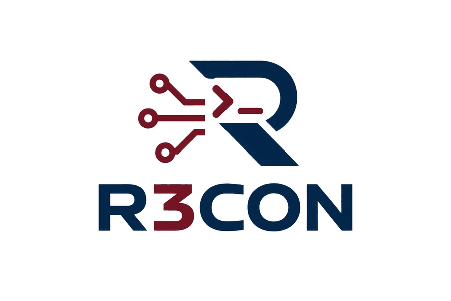
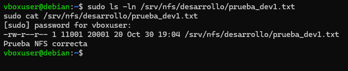
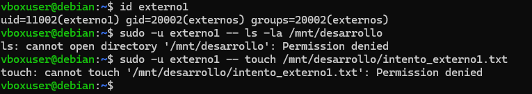
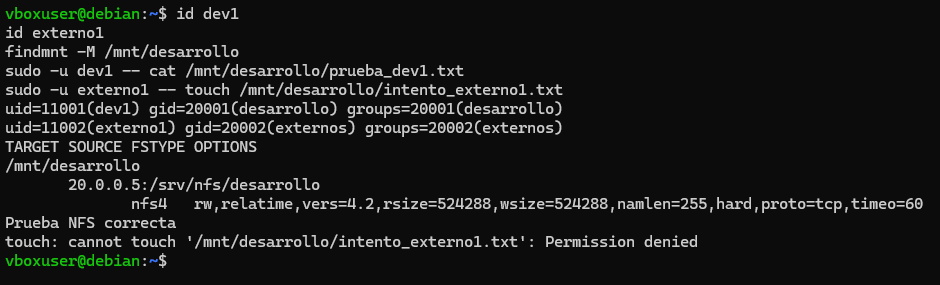
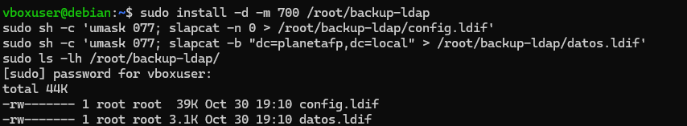
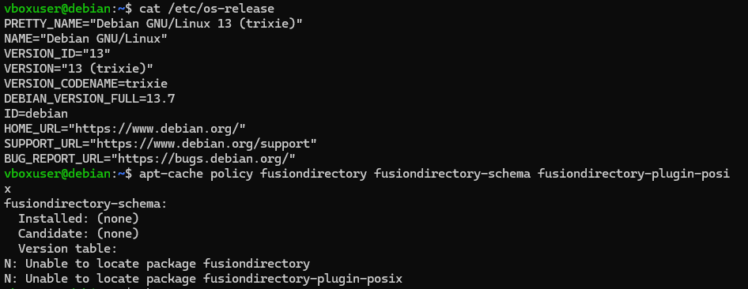

<p align="center">
  
</p>
<details>
<summary><h2><b> 💡Idea Proyecto </b></h2></summary>

# 🛡️ R3CON

### Análisis continuo de seguridad para pymes

R3econ es un proyecto de plataforma que transforma el análisis técnico de una infraestructura en **hallazgos comprensibles, informes periódicos y alertas accionables**.

La propuesta consiste en desplegar dos contenedores Podman en un entorno autorizado por el cliente. Estos identifican activos y servicios, realizan comprobaciones de seguridad y envían los resultados a una plataforma central. El cliente puede consultar la evolución de su infraestructura desde un portal privado, descargar informes PDF y recibir avisos relevantes por Telegram.

> **Estado del proyecto:** fase de diseño. La arquitectura, las funcionalidades y los precios descritos son propuestas pendientes de implementación y validación.

## 🎯 Objetivo

Ayudar a pymes y startups sin un equipo especializado de ciberseguridad a responder tres preguntas:

- ¿Qué dispositivos y servicios tenemos en nuestra infraestructura?
- ¿Qué posibles riesgos se han detectado y con qué grado de confianza?
- ¿Qué deberíamos corregir primero?

SecureReport se plantea como un servicio de **análisis continuo de exposición y vulnerabilidades**. No sustituye una auditoría manual completa, un pentest profesional ni una certificación de cumplimiento.

## 🧭 Funcionamiento previsto

1. **Alta del cliente:** la organización accede al portal y define los activos, redes, interfaces y horarios autorizados.
2. **Despliegue de agentes:** instala dos contenedores Podman con permisos ajustados a las funciones que realizará cada uno.
3. **Recopilación y análisis:** los agentes descubren servicios y ejecutan comprobaciones no destructivas dentro del alcance acordado.
4. **Procesamiento central:** la API recibe resultados estructurados; el backend los valida, correlaciona y prioriza.
5. **Entrega de resultados:** el cliente consulta el dashboard, recibe informes PDF y obtiene avisos por Telegram cuando corresponde.
6. **Seguimiento:** el portal permite revisar hallazgos, registrar avances y comunicarse con el equipo.

## 🏗️ Arquitectura propuesta

```text
                 INFRAESTRUCTURA DEL CLIENTE
           ┌──────────────────────────────────────┐
           │ Contenedor 1: red y tráfico           │
           │ Nmap · TShark / dumpcap               │
           ├──────────────────────────────────────┤
           │ Contenedor 2: análisis de seguridad   │
           │ Comprobaciones · evidencia · hallazgos│
           └──────────────────┬───────────────────┘
                              │
                      Comunicación protegida
                              │
                              ▼
                  ┌─────────────────────────┐
                  │ API central · FastAPI   │
                  └────────────┬────────────┘
                               │
                     PostgreSQL + workers
                               │
                ┌──────────────┼──────────────┐
                ▼              ▼              ▼
          Portal privado   Informes PDF    n8n + Telegram
          y mensajería     e histórico     y apoyo de IA
```

| Componente | Responsabilidad | Tecnologías propuestas |
|---|---|---|
| **Contenedor 1 · Sensor de red** | Descubrimiento de activos, puertos y servicios; obtención opcional de indicadores de tráfico. | Podman, Nmap, TShark/dumpcap |
| **Contenedor 2 · Analizador** | Comprobaciones de seguridad no destructivas y preparación de hallazgos con evidencia. | Podman, Python y módulos de análisis |
| **API y base de datos** | Recepción de resultados, autenticación, separación de clientes e histórico. | FastAPI, PostgreSQL |
| **Procesamiento** | Correlación, deduplicación, priorización y generación de informes. | Workers y generador de PDF |
| **Portal y comunicaciones** | Dashboard, informes, mensajería del cliente y notificaciones. | Web, correo, n8n y Telegram |

## 🔎 Agentes de análisis

### Contenedor 1: red y tráfico

El primer contenedor utilizará **Nmap** para descubrir equipos, puertos y servicios dentro de los rangos autorizados. De forma opcional, podrá emplear **TShark o dumpcap** para obtener información de tráfico en interfaces concretas.

La captura de tráfico no se activará por defecto. Su alcance dependerá de la ubicación del agente, los permisos disponibles y la autorización del cliente. Instalar el contenedor en un servidor **no implica poder observar toda la red**.

### Contenedor 2: análisis de seguridad

El segundo contenedor trabajará sobre los activos y servicios detectados para ejecutar comprobaciones adicionales de bajo impacto. Cada resultado deberá incluir:

- Activo y servicio afectados.
- Regla aplicada o referencia técnica.
- Evidencia que respalda el hallazgo.
- Severidad y grado de confianza.
- Recomendación de corrección.
- Estado de revisión o remediación.

Una versión de software detectada puede sugerir un posible CVE, pero **no confirma por sí sola que el sistema sea vulnerable**. Los resultados dudosos se marcarán como pendientes de verificación.

## 🤖 IA y automatización con n8n

La IA se plantea como una herramienta de **apoyo al análisis**, no como autoridad final. Podrá ayudar a agrupar hallazgos repetidos, resumir evidencias y redactar recomendaciones claras para el cliente. Los resultados importantes o inciertos deberán poder revisarse antes de presentarse como confirmados.

**n8n** coordinará procesos como la generación periódica de informes, las solicitudes de revisión y el envío de avisos. La lógica principal de seguridad, la autenticación y el control de permisos permanecerán en el backend.

```text
Nuevo hallazgo
    → Validación y deduplicación
    → Priorización
    → Revisión si existe incertidumbre
    → Publicación en el portal
    → Aviso por Telegram, si procede
    → Inclusión en el informe periódico
```

## 📊 Portal, mensajería e informes

El proyecto contempla dos espacios web diferenciados:

- **Web pública:** presentación de la empresa, explicación del servicio, planes y contacto.
- **Portal privado:** acceso del cliente al dashboard, inventario, hallazgos, informes y mensajería con el equipo.

El **informe PDF periódico** incluirá un resumen ejecutivo, cambios desde el informe anterior, hallazgos priorizados, evidencia técnica, recomendaciones y estado de remediación.

Telegram servirá como **canal de aviso**, no como repositorio de información sensible. Por ejemplo, una notificación podrá indicar que se ha detectado un hallazgo de prioridad alta y dirigir al cliente al portal autenticado para consultar los detalles.

## 🔐 Seguridad y límites

El sistema debe construirse aplicando el principio de **mínimo privilegio** tanto a los agentes como a la plataforma central.

- Escanear únicamente redes y activos con autorización expresa.
- Definir horarios, límites de velocidad y exclusiones antes de ejecutar pruebas.
- No montar `/var/run/docker.sock` ni usar `--network host` por defecto.
- Limitar la captura a interfaces y permisos específicamente autorizados.
- Enviar preferentemente resultados estructurados y metadatos mínimos, no capturas completas de paquetes.
- Proteger la comunicación, las credenciales de los agentes y la separación de datos entre clientes.
- Mantener trazabilidad de escaneos, cambios y accesos.
- Definir políticas de conservación y tratamiento de los datos obtenidos.

> **Importante:** SecureReport no debe presentarse como una garantía de ausencia de vulnerabilidades. Los escaneos automatizados tienen límites y pueden generar falsos positivos o no detectar determinados problemas.

## 🚀 Roadmap

| Fase | Objetivo | Entrega |
|---|---|---|
| **1 · Base técnica** | Demostrar el flujo completo en un laboratorio propio. | Nmap → API → PostgreSQL |
| **2 · Primer producto** | Hacer consultables los resultados. | Portal privado, inventario e informe PDF |
| **3 · Análisis** | Ampliar las comprobaciones sin perder calidad. | Segundo contenedor, evidencia, confianza y deduplicación |
| **4 · Comunicación** | Automatizar el seguimiento del cliente. | Telegram, mensajería web y flujos n8n |
| **5 · Validación** | Evaluar utilidad y seguridad reales. | IA supervisada y pilotos con organizaciones autorizadas |

## 💼 Modelo de negocio propuesto

| Plan | Precio orientativo | Enfoque |
|---|---:|---|
| **Starter** | 49 €/mes | Organizaciones pequeñas que necesitan inventario e informes periódicos. |
| **Business** | 99 €/mes | Mayor cobertura, seguimiento más frecuente y alertas. |
| **Enterprise / MSP** | Desde 299 €/mes | Varias sedes u organizaciones e integraciones acordadas. |

Estos precios son **hipótesis**, no tarifas definitivas. Antes de comercializar el servicio será necesario validar la demanda, el coste de operación y soporte, los límites de cada plan y la calidad de los hallazgos.


</details>


<details>
<summary><h2><b> 📅 Planificacion del proyecto </b></h2></summary>

# 🛡️ R3con — Planificación técnica del proyecto

> **R3con** es un prototipo funcional de reconocimiento y análisis continuo de seguridad para infraestructuras autorizadas. El proyecto se desarrolla como Trabajo Final de Ciclo de **ASIX, perfil de ciberseguridad**, por Raúl, Ricard y Jam.

**Estado:** fase de planificación y diseño de arquitectura.  
**Idioma:** español.  
**Entorno de demostración:** laboratorio aislado en VirtualBox/Proxmox.  
**Fecha objetivo de finalización:** antes de abril.

---

## 🎯 1. Objetivo del proyecto

R3con tiene como objetivo demostrar, en un laboratorio controlado, cómo una plataforma web puede:

- Descubrir equipos, puertos y servicios de una red autorizada mediante **Nmap**.
- Analizar indicadores y metadatos de red utilizando **TShark/Wireshark**, sin almacenar capturas PCAP completas.
- Detectar configuraciones o servicios que requieran revisión mediante reglas no destructivas.
- Centralizar resultados en una aplicación web con autenticación, roles y dashboard.
- Generar informes PDF automáticos diarios, semanales o bajo demanda.
- Enviar alertas críticas mediante un bot de Telegram.
- Automatizar tareas con **n8n**.
- Investigar e integrar **MicroCloud** como parte de la innovación y el aprendizaje de infraestructura privada.

> R3con no será una herramienta de explotación, ni realizará ataques contra redes externas. Todas las pruebas se limitarán a máquinas virtuales propias y a rangos de red explícitamente autorizados.

---

## ✅ 2. Alcance del MVP

### Funcionalidades obligatorias

| Funcionalidad | Descripción |
|---|---|
| Descubrimiento de red | Identificación de hosts, puertos y servicios con Nmap dentro de un CIDR autorizado |
| Análisis de tráfico | Obtención de metadatos y protocolos con TShark/dumpcap en el laboratorio |
| Reglas de seguridad | Detección de configuraciones o servicios que requieran revisión |
| Agentes Podman | Dos contenedores separados: sensor y analizador |
| Aplicación web | Login real, roles, dashboard, activos, hallazgos e informes |
| Base de datos | Persistencia de usuarios, escaneos, activos, hallazgos e informes en MariaDB/MySQL |
| PDF | Generación real de informes periódicos y bajo demanda |
| Telegram | Bot con alertas críticas y resumen de estado |
| MicroCloud | Prueba docente de despliegue y documentación de su integración |

### Mejoras futuras

- Asistente de IA dentro del portal.
- Explicaciones automáticas de hallazgos para usuarios no técnicos.
- Clasificación avanzada de riesgos mediante IA.
- Chat de soporte integrado.
- Integración con correo electrónico.
- MFA para usuarios administrativos.
- Más reglas y módulos de análisis.

---

## 🏗️ 3. Arquitectura general

```text
                           LABORATORIO R3CON
┌──────────────────────────────────────────────────────────────────────┐
│                      Red interna VirtualBox                          │
│                                                                      │
│  ┌───────────────────┐       ┌───────────────────────────────────┐  │
│  │ VM objetivo 1     │       │ VM objetivo 2                     │  │
│  │ Debian / Ubuntu   │       │ Kali / Ubuntu de práctica         │  │
│  │ SSH · HTTP · DNS  │       │ Servicios de laboratorio          │  │
│  └─────────▲─────────┘       └──────────────▲────────────────────┘  │
│            │                                │                       │
│            └─────────── Escaneo autorizado ─┘                       │
│                                                                      │
│  ┌──────────────────────────────────────────────────────────────┐  │
│  │ VM R3con Agent                                                 │  │
│  │ Ubuntu Server + Podman                                         │  │
│  │                                                               │  │
│  │ ┌──────────────────────┐  ┌────────────────────────────────┐ │  │
│  │ │ r3con-sensor         │  │ r3con-analyzer                 │ │  │
│  │ │ Nmap                 │  │ TShark + reglas seguras        │ │  │
│  │ │ Hosts/puertos/serv.  │  │ Hallazgos JSON                 │ │  │
│  │ └──────────┬───────────┘  └──────────────┬─────────────────┘ │  │
│  └────────────┼─────────────────────────────┼───────────────────┘  │
└───────────────┼─────────────────────────────┼──────────────────────┘
                └───────────────┬─────────────┘
                                HTTPS
                                  │
                                  ▼
┌──────────────────────────────────────────────────────────────────────┐
│                          R3CON CORE                                  │
│                    Ubuntu Server / MicroCloud                        │
│                                                                      │
│ FastAPI ── MariaDB ── Worker ── PDF ── n8n ── Telegram              │
│      │                                                               │
│      ├── Dashboard web HTML/CSS/JavaScript                           │
│      ├── Login y control de roles                                    │
│      ├── Histórico de escaneos e informes                            │
│      └── Alertas críticas y resumen periódico                        │
└──────────────────────────────────────────────────────────────────────┘
```

### Flujo principal

```text
Política de alcance autorizada
        ↓
R3con Sensor y R3con Analyzer
        ↓
Resultados JSON estructurados
        ↓
API FastAPI mediante HTTPS
        ↓
MariaDB + procesamiento asíncrono
        ↓
Hallazgos priorizados, dashboard e informes PDF
        ↓
Alertas críticas por Telegram y automatizaciones n8n
```

---

## 🧩 4. Componentes principales

| Componente | Responsabilidad | Tecnologías propuestas |
|---|---|---|
| `r3con-sensor` | Descubre hosts, puertos y servicios en los rangos permitidos | Podman, Python, Nmap |
| `r3con-analyzer` | Ejecuta comprobaciones no destructivas, procesa metadatos de tráfico y crea hallazgos | Podman, Python, TShark/dumpcap, reglas YAML/JSON |
| R3con Core | Recibe resultados, valida datos, centraliza lógica y expone API | Python, FastAPI, Pydantic |
| Base de datos | Guarda clientes, usuarios, políticas, activos, escaneos y hallazgos | MariaDB/MySQL |
| Worker | Deduplica, prioriza, genera PDF y activa alertas | Python, tareas asíncronas |
| R3con Console | Portal con login, dashboard, informes y estado de remediación | HTML, CSS, JavaScript |
| Automatización | Programa procesos, notificaciones y flujos de soporte | n8n |
| Bot R3con Notify | Envía avisos críticos y resúmenes al grupo o usuario autorizado | Telegram Bot API |
| MicroCloud | Laboratorio de nube privada y orquestación de instancias | MicroCloud, LXD, MicroOVN, MicroCeph opcional |

---

## 🖥️ 5. Infraestructura del laboratorio

Se utilizará una red aislada de VirtualBox. Las máquinas objetivo no estarán conectadas a una red puente doméstica o del centro, evitando análisis fuera del laboratorio.

| Máquina virtual | Sistema operativo | CPU | RAM | Disco | Función |
|---|---|---:|---:|---:|---|
| `r3con-core` | Ubuntu Server 24.04 LTS | 2 vCPU | 4 GB | 40 GB | API, MariaDB, dashboard, worker, PDF y n8n |
| `r3con-agent` | Ubuntu Server 24.04 LTS | 2 vCPU | 2 GB | 25 GB | Podman, sensor y analizador |
| `target-web` | Ubuntu Server o Debian | 1–2 vCPU | 2 GB | 20 GB | HTTP/HTTPS, SSH y servicios de prueba |
| `target-services` | Debian, Ubuntu o Kali | 1–2 vCPU | 2 GB | 20 GB | DNS, SSH u otros servicios de laboratorio |

### Diseño de red

```text
Red NAT
└── Uso exclusivo de r3con-core:
    - Actualizaciones de software.
    - Comunicación con Telegram.
    - Uso opcional de una API de IA.

Red interna: r3con-lab
├── r3con-core
├── r3con-agent
├── target-web
└── target-services
```

> Si el equipo anfitrión no dispone de suficiente RAM, se reducirán temporalmente las VMs objetivo a 1 GB, o se levantarán únicamente las máquinas necesarias para cada prueba.

---

## ☁️ 6. Integración de MicroCloud

MicroCloud se incluirá como innovación técnica y entorno de aprendizaje, sin bloquear el funcionamiento del MVP.

### Fase A: MVP sin dependencia de MicroCloud

El sistema funcionará inicialmente con las VMs descritas anteriormente. Esta fase permite completar el flujo de valor antes de añadir complejidad adicional:

```text
Nmap → JSON → API → MariaDB → Dashboard → PDF → Telegram
```

### Fase B: demostración de MicroCloud

Se desplegará MicroCloud en una VM o en un grupo de VMs Ubuntu para probar la creación y gestión de instancias LXD. La plataforma R3con Core podrá desplegarse en una instancia separada.

```text
MicroCloud de laboratorio
│
├── Instancia LXD: r3con-core
│   ├── FastAPI
│   ├── MariaDB
│   ├── n8n
│   └── Portal R3con
│
├── Instancia LXD: r3con-monitoring
│   └── Logs, copias o pruebas de monitorización
│
└── Red virtual gestionada
    └── Aislamiento de servicios del laboratorio
```

Para un proyecto académico se puede usar un único nodo con fines de prueba. No se describirá como alta disponibilidad. Un clúster con tolerancia a fallos requiere más nodos y una configuración adicional de almacenamiento distribuido.

---

## 🐳 7. Agentes Podman

### Contenedor 1: `r3con-sensor`

**Responsabilidad:** descubrimiento de red dentro del alcance permitido.

Funciones:

- Ejecutar perfiles Nmap seguros sobre CIDR autorizados.
- Detectar hosts activos, puertos y servicios.
- Registrar versiones observables cuando estén disponibles.
- Convertir resultados de Nmap a JSON normalizado.
- Enviar resultados a la API mediante HTTPS.
- Ejecutarse manualmente o mediante programación diaria/semanal.

### Contenedor 2: `r3con-analyzer`

**Responsabilidad:** interpretar resultados y generar hallazgos técnicos.

Funciones:

- Consumir resultados normalizados del sensor.
- Aplicar reglas no destructivas para identificar riesgos potenciales.
- Usar TShark/dumpcap para generar metadatos de red cuando el laboratorio lo permita.
- Detectar ejemplos como SSH expuesto, Telnet habilitado, HTTP sin HTTPS, certificados próximos a caducar o servicios que requieren revisión.
- Crear resultados JSON con activo, evidencia, severidad, confianza y recomendación.

> No se almacenarán ficheros PCAP completos. Solo se conservarán metadatos y resultados necesarios para demostrar el análisis.

---

## 🔐 8. Control de alcance y seguridad

El sistema no permitirá introducir libremente comandos Nmap desde el dashboard. Cada agente ejecutará únicamente políticas de escaneo previamente configuradas.

Ejemplo de política:

```json
{
  "policy_id": "lab-policy-01",
  "allowed_cidrs": ["10.10.10.0/24"],
  "allowed_ports": "1-1024",
  "scan_profile": "safe",
  "max_hosts": 20,
  "excluded_hosts": ["10.10.10.1"],
  "schedule": "daily"
}
```

Antes de iniciar un análisis, el agente deberá:

1. Validar que el destino pertenece a un rango de red privado autorizado.
2. Comprobar que el CIDR coincide con la política recibida.
3. Rechazar direcciones IP públicas, dominios y argumentos arbitrarios.
4. Aplicar límites de hosts, puertos, velocidad y tiempo de ejecución.
5. Registrar toda ejecución y resultado.
6. Utilizar perfiles de escaneo predefinidos, como `safe`, en lugar de aceptar parámetros libres.

Medidas adicionales:

- Autenticación real con contraseñas hasheadas mediante Argon2id o bcrypt.
- JWT con caducidad y control de roles.
- HTTPS entre agentes y API.
- Credenciales de agente revocables.
- Validación de JSON y límite de tamaño de carga.
- Registro de auditoría de accesos, cambios de estado y descargas de informes.
- Separación lógica de datos por organización.
- Variables de entorno para secretos; nunca guardar credenciales en GitHub.
- MFA planteado como mejora futura después del MVP.

---

## 👥 9. Roles de usuario

| Rol | Permisos |
|---|---|
| Administrador R3con | Gestiona organizaciones, usuarios, políticas, agentes, reglas y auditoría global |
| Administrador cliente | Gestiona usuarios de su organización, consulta activos, informes y hallazgos; puede cambiar estados |
| Técnico cliente | Consulta activos y hallazgos de su organización; añade comentarios y marca estado, sin gestionar usuarios ni alcance |

### Estados de un hallazgo

```text
nuevo → revisado → resuelto
               └→ aceptado
```

- **Nuevo:** hallazgo recién detectado.
- **Revisado:** un usuario ha confirmado que conoce el hallazgo.
- **Resuelto:** se ha aplicado una corrección y se puede verificar posteriormente.
- **Aceptado:** el cliente acepta temporalmente el riesgo con una justificación.

---

## 🗄️ 10. Datos almacenados en la demostración

Durante la demo se almacenarán exclusivamente datos generados en el laboratorio:

- Direcciones IP privadas de las máquinas virtuales.
- Nombres de host y servicios instalados en las VMs de prueba.
- Puertos, protocolos y versiones detectadas.
- Resultados normalizados de Nmap.
- Metadatos de tráfico obtenidos con TShark.
- Hallazgos derivados de reglas internas.
- Usuarios de prueba y sus roles.
- Registros de acceso y acciones administrativas.
- Mensajes internos de soporte.
- Informes PDF generados.

No se almacenarán contraseñas reales, información de terceros, datos procedentes de Internet ni capturas PCAP completas.

---

## 🧠 11. Backend, frontend y lógica de negocio

### Stack tecnológico

| Capa | Tecnología | Uso |
|---|---|---|
| Backend | Python + FastAPI | API REST, autenticación, validación y lógica de negocio |
| Agentes | Python + Bash | Ejecución y normalización de Nmap/TShark |
| Frontend | HTML + CSS + JavaScript | Login, dashboard, tablas y vistas de informes |
| Base de datos | MariaDB/MySQL | Persistencia de usuarios, activos, hallazgos y PDFs |
| Informes | ReportLab o WeasyPrint | Generación de PDF |
| Automatización | n8n | Flujos, programación, soporte y notificaciones |
| Alertas | Telegram Bot API | Avisos críticos y resúmenes |
| Contenedores | Podman | Separación y despliegue de agentes |
| Infraestructura | VirtualBox, Proxmox y MicroCloud | Laboratorio y pruebas de nube privada |

### Flujo de negocio

```text
1. El administrador R3con crea la organización y usuarios de prueba.
2. Se define una política de alcance para el laboratorio.
3. Se registra el agente y se le asigna una identidad.
4. El agente ejecuta Nmap y comprobaciones permitidas.
5. Los resultados se normalizan y se envían mediante HTTPS.
6. FastAPI valida los datos y los guarda en MariaDB.
7. El worker deduplica y prioriza hallazgos.
8. El dashboard muestra activos, hallazgos y estados.
9. El sistema genera informes PDF periódicos o bajo demanda.
10. Si existe un hallazgo crítico, el bot de Telegram envía una alerta.
```

### Priorización de riesgos

La prioridad no dependerá únicamente de una severidad técnica. Se utilizará una puntuación interna orientativa:

\[
Riesgo = Severidad \times Exposición \times Criticidad\ del\ activo \times Confianza
\]

| Factor | Valores iniciales |
|---|---|
| Severidad | Bajo, medio, alto, crítico |
| Exposición | Interno, accesible desde varias redes, expuesto en el laboratorio |
| Criticidad del activo | Laboratorio, servidor interno, servicio relevante |
| Confianza | Indicio, probable, verificado |

---

## 📦 12. Modelo de datos inicial

```text
organizations
├── users
├── agents
├── scan_policies
├── assets
│   ├── services
│   └── findings
├── scans
├── reports
├── notifications
├── support_messages
└── audit_logs
```

| Entidad | Información principal |
|---|---|
| `organizations` | Nombre, plan de demostración, estado y fecha de alta |
| `users` | Organización, email, hash de contraseña, rol y estado |
| `agents` | Organización, versión, estado, última conexión y credencial |
| `scan_policies` | CIDR permitido, horarios, perfiles, exclusiones y límites |
| `assets` | IP, hostname, tipo, criticidad y exposición |
| `services` | Activo, puerto, protocolo, producto y versión observada |
| `scans` | Agente, política, fechas, estado y errores |
| `findings` | Activo, regla, severidad, evidencia, confianza y estado |
| `reports` | Organización, periodo, archivo, hash y fecha de generación |
| `notifications` | Hallazgo, canal, destinatario y resultado de entrega |
| `support_messages` | Organización, autor, mensaje y estado |
| `audit_logs` | Actor, acción, recurso, fecha y resultado |

---

## 📡 13. Endpoints mínimos de la API

| Método | Ruta | Función |
|---|---|---|
| `POST` | `/api/v1/auth/login` | Inicio de sesión |
| `POST` | `/api/v1/auth/refresh` | Renovación controlada de sesión |
| `GET` | `/api/v1/dashboard` | Resumen de la organización autenticada |
| `GET` | `/api/v1/assets` | Activos detectados |
| `GET` | `/api/v1/findings` | Hallazgos filtrables |
| `PATCH` | `/api/v1/findings/{id}` | Cambiar estado o añadir gestión del hallazgo |
| `GET` | `/api/v1/reports` | Histórico de informes |
| `GET` | `/api/v1/reports/{id}/download` | Descarga protegida de PDF |
| `POST` | `/api/v1/agents/enroll` | Registro controlado de agente |
| `POST` | `/api/v1/agents/{id}/results` | Envío de resultados JSON |
| `POST` | `/api/v1/agents/{id}/heartbeat` | Estado y última conexión del agente |
| `POST` | `/api/v1/messages` | Mensajería de soporte |

---

## 🤖 14. Automatización, Telegram e IA

### Automatización con n8n

n8n tendrá un papel de apoyo, no reemplazará el backend:

- Programar informes diarios o semanales.
- Recibir eventos o webhooks del backend.
- Activar envío de alertas Telegram.
- Crear flujos de recordatorio de hallazgos pendientes.
- Conectar con un futuro asistente IA.
- Automatizar respuestas básicas de soporte, siempre con control humano.

### Alertas Telegram

El bot enviará:

- Alertas de hallazgos críticos.
- Avisos de agente desconectado.
- Resumen diario o semanal.
- Enlace al portal web autenticado.

No enviará datos técnicos sensibles completos ni credenciales dentro de Telegram.

### IA como mejora futura

La IA se añadirá solo después de completar el MVP. Las posibles funciones son:

- Explicar recomendaciones técnicas para usuarios no especializados.
- Resumir hallazgos de un informe.
- Clasificar propuestas de prioridad con revisión humana.
- Asistente de soporte dentro del portal.
- Analizar logs de forma asistida.

La IA no podrá ejecutar escaneos, modificar políticas ni confirmar automáticamente una vulnerabilidad.

---

## 👨‍💻 15. Reparto de tareas

| Integrante | Responsabilidad principal | Entregables previstos |
|---|---|---|
| **Raúl** | Sistemas, redes y documentación técnica | VMs, red VirtualBox/Proxmox, Podman, Nmap, TShark, despliegue, pruebas, diagramas y manual técnico |
| **Ricard** | Backend, base de datos y supervisión documental | FastAPI, MariaDB, API, autenticación, modelo de datos, PDF y revisión de memoria |
| **Jam** | Frontend, diseño y documentación visual | Login, dashboard, vistas de hallazgos e informes, manual de usuario y apoyo transversal |
| **Equipo completo** | Integración, automatización y defensa | Telegram, n8n, pruebas, evidencias, memoria, presentación y demostración final |

---

## 🗓️ 16. Plan de trabajo

| Fase | Objetivo | Resultado esperado |
|---|---|---|
| 1. Laboratorio | Crear VMs, red aislada y repositorio | Topología funcional y documentación de IPs |
| 2. Sensor | Implementar Nmap y JSON | Descubrimiento real de objetivos del laboratorio |
| 3. Backend | API, MariaDB, login y roles | Resultados almacenados y accesibles por API |
| 4. Dashboard | Portal, activos, hallazgos y estados | Aplicación web funcional |
| 5. Informes | PDF automático y descarga protegida | Informe real basado en datos del laboratorio |
| 6. Alertas | Telegram y n8n | Aviso crítico y resumen periódico |
| 7. MicroCloud | Prueba docente e integración opcional | Evidencia de nube privada/LXD documentada |
| 8. Mejoras | IA, MFA o funciones extra si hay tiempo | Funcionalidades opcionales sin afectar el MVP |
| 9. Entrega | Memoria, presentación y demo | Proyecto defendible y reproducible |

---

## 📌 17. Criterios de éxito

El prototipo se considerará funcional si permite demostrar de extremo a extremo:

```text
Red de laboratorio autorizada
        ↓
Escaneo Nmap desde R3con Sensor
        ↓
Resultados enviados a FastAPI
        ↓
Datos almacenados en MariaDB
        ↓
Hallazgo visible en el dashboard
        ↓
Informe PDF generado
        ↓
Alerta crítica recibida en Telegram
```

La prioridad será entregar este flujo de forma estable, documentada y reproducible antes de añadir IA, MFA, nuevas herramientas o características complejas.

---

## ⚠️ Nota sobre seguridad y ética

Todas las herramientas se usarán exclusivamente contra máquinas virtuales propias y redes creadas para el laboratorio. Cada exploración estará limitada mediante una política de alcance para impedir objetivos externos, argumentos arbitrarios o redes no autorizadas.
</details>

<details>
<summary><h2><b> 📌 Planificación de arquitectura </b></h2></summary>
# 🛡️ R3con — Planificación de arquitectura

> Trabajo Final de Ciclo de ASIX, perfil de ciberseguridad.  
> Documento preliminar de arquitectura y planificación para la actividad M0379 / Proyecto.

| Dato | Información |
|---|---|
| Proyecto | R3con |
| Integrantes | Raúl Ortiz, Ricard Forero y Jam Arango |
| Ciclo | ASIX, perfil de ciberseguridad |
| Módulo | M0379 / Proyecto |
| Fecha del documento | 15 de octubre de 2026 |
| Entrega de esta actividad | 22 de octubre de 2026 |
| Idioma | Español |
| Estado | Planificación preliminar |
| Formato de entrega | URL a la documentación compartida en GitHub |

> ⚠️ Este documento recoge las decisiones del equipo y una propuesta de despliegue. Quedan pendientes la ubicación definitiva de Proxmox, los recursos físicos disponibles, las versiones instaladas, el direccionamiento final y las evidencias de funcionamiento.

---

## 🎯 1. Objetivo del proyecto

R3con es un prototipo funcional de reconocimiento y análisis continuo de seguridad para infraestructuras autorizadas.

Su finalidad es integrar conocimientos de administración de sistemas, redes, desarrollo web, bases de datos y ciberseguridad mediante un laboratorio controlado.

Las funcionalidades previstas son:

- Descubrir equipos, puertos y servicios con Nmap.
- Obtener indicadores y metadatos de tráfico con TShark/Wireshark.
- Detectar configuraciones que requieran revisión mediante reglas no destructivas.
- Centralizar los resultados en una aplicación web con autenticación y roles.
- Consultar activos, hallazgos e informes desde un dashboard.
- Generar informes PDF periódicos.
- Enviar alertas críticas mediante Telegram.
- Automatizar procesos mediante n8n.
- Incorporar MicroCloud como parte de la entrega final del proyecto.

No se almacenarán capturas PCAP completas ni se analizarán redes externas.

> R3con complementa el análisis técnico de una infraestructura. No se presenta como una herramienta de explotación ni como sustituto de una auditoría manual completa.

---

## ✅ 2. Decisiones confirmadas

| Área | Decisión |
|---|---|
| Backend | Python + FastAPI |
| Frontend | HTML, CSS y JavaScript |
| Base de datos | MariaDB como tecnología propuesta |
| Usuarios | Creados por el administrador, sin registro público |
| Autenticación | Login real con contraseñas hasheadas y control de roles |
| Informes | PDF reales generados por el sistema |
| Alertas | Bot de Telegram |
| Automatización | n8n como apoyo al backend |
| Contenedores | Podman |
| Documentación | GitHub colaborativo |
| Idioma | Español |
| IA | Ampliación posterior al funcionamiento del MVP |
| MicroCloud | Debe funcionar para la entrega final; no es el objetivo inmediato de la actividad del 22 de octubre |
| Disponibilidad | Entre 5 y 10 horas semanales indicadas por el equipo; pendiente concretar si son por persona o para el grupo |

### Estado declarado del laboratorio

El equipo confirma que las siguientes máquinas están creadas y configuradas:

- `r3con-core`
- `r3con-agent`
- `target-web`

Las direcciones IP, versiones instaladas y pruebas de conectividad se incorporarán a la documentación cuando se registren sus valores reales.

---

## 🖥️ 3. Aclaración sobre VirtualBox y Proxmox

Es necesario concretar dónde se ejecutarán las máquinas de la entrega.

Proxmox VE administra las máquinas virtuales y contenedores alojados en su propia infraestructura. No funciona como un panel de administración directa de máquinas que continúan ejecutándose en VirtualBox.

| Caso | Entorno | Implicación |
|---|---|---|
| A | Proxmox instalado en otro equipo físico | Las VMs de la entrega se ejecutarán en ese servidor. VirtualBox quedará como laboratorio previo. |
| B | Proxmox instalado dentro de una VM de VirtualBox | Las VMs se crearán dentro de Proxmox; habrá que verificar compatibilidad y recursos para virtualización anidada. |
| C | Proxmox separado, pero las VMs siguen ejecutándose en VirtualBox | Será necesario revisar el diseño, porque esas VMs no estarán gestionadas directamente por Proxmox. |

> No se eliminarán las máquinas actuales hasta confirmar el entorno definitivo y decidir cómo aprovechar el trabajo realizado.

---

## 🏗️ 4. Distribución propuesta de máquinas

La actividad exige cuatro máquinas virtuales servidor separadas y una máquina cliente adicional.

Para integrar las funciones de R3con se conservarán, además, el agente de análisis y el objetivo de pruebas.

| Máquina | Función | Acción prevista |
|---|---|---|
| `r3con-web` | Servidor web, frontend y API FastAPI | Reutilizar la función de `r3con-core` y separar la base de datos si estuviera alojada allí |
| `r3con-db` | Base de datos MariaDB | Crear una VM dedicada |
| `r3con-net` | DNS y DHCP | Crear una VM dedicada |
| `r3con-backup` | Copias de seguridad y pruebas de restauración | Crear una VM dedicada |
| `r3con-client` | Cliente con navegador e IP asignada por DHCP | Crear una VM cliente |
| `r3con-agent` | Agentes Podman y herramientas de análisis | Conservar la VM existente |
| `target-web` | Objetivo autorizado para los análisis | Conservar la VM existente |

### Gateway

El gateway deberá proporcionar el enrutamiento y reenvío de puertos que solicita la actividad.

Está pendiente confirmar si:

- Lo proporciona el centro.
- Se puede configurar en la infraestructura disponible.
- Debe implementarse como una máquina virtual adicional.

---

## 🌐 5. Arquitectura lógica propuesta

El siguiente esquema representa funciones y relaciones entre componentes. No es todavía la topología de red definitiva.

```text
Ordenador físico de demostración
              │
      Acceso por dominio
              │
              ▼
Gateway / reenvío de puertos
              │
              ▼
        r3con-web
   ┌─────────────────────┐
   │ Servidor web        │
   │ Frontend            │
   │ API FastAPI         │
   └──────────┬──────────┘
              │
              ▼
         r3con-db
   ┌─────────────────────┐
   │ MariaDB             │
   │ Usuarios y roles    │
   │ Activos y hallazgos │
   │ Histórico           │
   └─────────────────────┘

Servicios de infraestructura
├── r3con-net
│   ├── DNS
│   └── DHCP
├── r3con-backup
│   └── Copias y restauración
└── r3con-client
    └── Navegador e IP por DHCP

Laboratorio de análisis R3con
├── r3con-agent
│   ├── Contenedor sensor
│   └── Contenedor analizador
└── target-web
    └── Servicios de prueba autorizados
```

El diagrama definitivo deberá incluir:

- Equipo físico e hipervisor.
- Máquinas virtuales.
- Interfaces de red.
- Subredes.
- Direcciones IP.
- Gateway.
- Reenvío de puertos.
- Resolución DNS.
- Separación entre elementos físicos y virtuales.

---

## 🧩 6. Componentes de software

Estas tecnologías son decisiones propuestas. Las versiones exactas se anotarán después de comprobar las instalaciones.

| Componente | Tecnología propuesta | Uso |
|---|---|---|
| Sistema operativo de servidores | Ubuntu Server | Alojamiento de servicios y aplicación |
| Servidor web | Nginx | Publicación del frontend y acceso a la API |
| Backend | Python + FastAPI | Autenticación, lógica de negocio y API |
| Frontend | HTML, CSS y JavaScript | Portal de usuario y dashboard |
| Base de datos | MariaDB | Persistencia de usuarios y resultados |
| Contenedores | Podman | Ejecución de agentes |
| Descubrimiento | Nmap | Identificación de equipos y servicios |
| Análisis de tráfico | TShark/dumpcap | Obtención de metadatos autorizados |
| Automatización | n8n | Flujos y notificaciones |
| Alertas | Telegram Bot API | Avisos críticos y resúmenes |
| Nube privada | MicroCloud | Integración para la entrega final |

### Datos pendientes para completar la tabla tecnológica

Para cada servicio se documentará:

- Versión instalada.
- Puerto de funcionamiento.
- Interfaz o dirección donde escucha.
- Dominio, si procede.
- Justificación de uso.
- Enlace a documentación oficial.

---

## 👥 7. Roles previstos

| Rol | Funciones |
|---|---|
| Administrador R3con | Gestiona organizaciones, usuarios, agentes, políticas y configuración global |
| Administrador cliente | Gestiona usuarios de su organización y consulta activos, hallazgos e informes |
| Técnico cliente | Consulta resultados, añade comentarios y actualiza estados de hallazgos |

La aplicación deberá comprobar tanto el rol como la organización del usuario antes de permitir acceso a datos o acciones.

---

## 🔐 8. Seguridad de la infraestructura

### Firewall y mínimo privilegio

- La base de datos solo aceptará conexiones de aplicación desde el servidor web/backend autorizado.
- Las excepciones administrativas o de copias deberán justificarse y limitarse.
- Solo se permitirán los puertos necesarios para cada servicio.
- No se expondrá la base de datos directamente a la red real.
- Se documentarán las reglas del firewall y sus pruebas.

### Administración segura

- Acceso SSH mediante claves.
- Credenciales fuera del repositorio.
- Archivos de ejemplo sin secretos reales.
- Usuarios de base de datos con permisos limitados.
- Consultas parametrizadas para prevenir inyección SQL.
- Registro de operaciones relevantes.

### Análisis autorizado

- Rangos de escaneo definidos expresamente.
- Sin argumentos de comandos libres introducidos desde la web.
- Perfiles de análisis controlados.
- Límites de tiempo y velocidad.
- Sin escaneos de redes externas.
- Sin almacenamiento de PCAP completos.

---

## 💾 9. Copias de seguridad

La máquina `r3con-backup` se utilizará para almacenar las copias previstas del proyecto.

El procedimiento deberá documentar:

1. Qué información se copia.
2. Desde qué servidor se obtiene.
3. Cómo se ejecuta la copia.
4. Dónde se almacena.
5. Qué permisos protegen los archivos.
6. Cuánto tiempo se conservan.
7. Cómo se restaura una copia.

> Una copia no se considerará validada únicamente por existir el archivo: deberá realizarse una restauración de prueba y registrar el resultado.

---

## 🧪 10. Hito de evaluación del 22 de octubre

La primera demostración consistirá en publicar una web de prueba sobre la infraestructura diseñada.

### Resultado objetivo

```text
Ordenador físico de clase
        ↓
Resolución del dominio personalizado
        ↓
Gateway y reenvío de puertos
        ↓
Servidor web
        ↓
Página de prueba R3con
```

También se comprobará el acceso desde la VM cliente, que deberá obtener su configuración de red mediante DHCP.

Para esta fase no es necesario presentar todo el dashboard terminado. La prioridad es demostrar la infraestructura cliente-servidor y el acceso por dominio.

### Evidencias que se deben recoger

- Máquinas virtuales creadas.
- Configuración de interfaces y direcciones.
- Cliente obteniendo configuración por DHCP.
- Resolución del dominio mediante el DNS del laboratorio.
- Página de prueba accesible desde la VM cliente.
- Página accesible por dominio desde una máquina física, si el entorno lo permite.
- Reenvío de puertos configurado.
- Conexión del backend con MariaDB.
- Restricción de acceso a la base de datos.
- Acceso SSH con claves.
- Copia y restauración de prueba.

---

## 🗓️ 11. Calendario propuesto

Las fechas siguientes son objetivos de trabajo, no evidencias de tareas realizadas.

| Fecha | Resultado esperado | Responsable principal |
|---|---|---|
| 16 de octubre | Confirmar Proxmox, hardware, inventario y topología | Raúl y equipo |
| 17–18 de octubre | Preparar VMs obligatorias y conectividad | Raúl |
| 18–19 de octubre | Configurar DNS, DHCP y web de prueba desde cliente virtual | Raúl y Jam |
| 19–20 de octubre | Separar MariaDB, probar backend y aplicar restricciones | Ricard |
| 20–21 de octubre | Probar copias, restauración, SSH con claves y acceso desde equipo físico | Equipo |
| 21 de octubre | Completar capturas, diagramas, documentación y ensayo | Equipo |
| 22 de octubre | Entregar URL y realizar la demostración acordada | Equipo |

### Trabajo en paralelo

- Ricard: modelo E-R, backend y revisión documental.
- Jam: mapa de navegación, wireframes y presentación de la web.
- Raúl: infraestructura, red y documentación técnica.
- Equipo: integración, pruebas y preparación de la defensa.

---

## 📚 12. Documentación pendiente de completar

### Matriz de requisitos

Se elaborará una tabla con los campos solicitados:

| ID | Prioridad | Objetivo | Funcionalidad | Disparador | Fecha de entrega | Estado |
|---|---|---|---|---|---|---|
| Por definir | Alta / Media / Baja | Necesidad a cubrir | Solución concreta | Acción o tarea que la inicia | Fecha prevista | Activo / Pendiente / Cancelado |

### Arquitectura tecnológica

Se documentarán tecnologías, versiones, puertos, dominios y justificación de cada elección.

### Base de datos

El diseño E-R incluirá:

- Tablas y campos.
- Tipos y límites de datos.
- Claves primarias y foráneas.
- Cardinalidades.
- Tablas intermedias para relaciones N:M cuando proceda.
- Restricciones necesarias para conservar la integridad.

### Interfaz

Se prepararán:

- Mapa de navegación.
- Wireframes.
- Roles y permisos.
- Descripción de los elementos principales de cada pantalla.

### Control de versiones

El repositorio GitHub contendrá:

- Código.
- Documentación.
- Diagramas.
- Evidencias seleccionadas.
- Manuales de instalación y pruebas.

No se incluirán contraseñas, tokens, claves privadas ni archivos `.env` con secretos.

---

## ❓ 13. Información pendiente de confirmar

| Punto | Información necesaria |
|---|---|
| Proxmox | Dónde está instalado y si ya se puede acceder a su interfaz |
| Hardware | Procesador, RAM y espacio SSD disponible del equipo que alojará las VMs |
| Dedicación | Si las 5–10 horas son por integrante o para el grupo |
| VMs actuales | Sistema, versión e IP de `r3con-core`, `r3con-agent` y `target-web` |
| Equipo de clase | Si se permite modificar su configuración DNS |
| Gateway | Si lo proporciona el centro o debe crearse |
| Reenvío de puertos | Quién puede configurar las reglas y en qué equipo |

---

## ☁️ 14. MicroCloud y ampliaciones

MicroCloud se implementará para la entrega final del proyecto, después de estabilizar la infraestructura básica.

No se condicionará el hito del 22 de octubre a su funcionamiento.

La IA también se incorporará como ampliación posterior, siempre que el flujo principal ya permita:

```text
Análisis autorizado
        ↓
Recepción de resultados
        ↓
Persistencia en base de datos
        ↓
Consulta desde el dashboard
        ↓
Informe PDF
        ↓
Alerta por Telegram
```

---

## 📌 15. Criterio de cierre de esta planificación

La planificación podrá considerarse cerrada cuando:

- [ ] Se confirme la infraestructura Proxmox.
- [ ] Se conozcan los recursos físicos disponibles.
- [ ] Se apruebe la distribución de VMs.
- [ ] Se complete el direccionamiento y dominio.
- [ ] Se documenten versiones y puertos.
- [ ] Se termine la matriz de requisitos.
- [ ] Se adjunte el modelo E-R.
- [ ] Se adjunten el mapa de navegación y los wireframes.
- [ ] Se registren las pruebas y evidencias de infraestructura.
- [ ] Se ensaye el acceso por dominio para la demostración.

---

## 📖 16. Base documental

- Enunciado: `A3-ArquitecturaSW.docx.pdf`, actividad de Arquitectura del Software, M0379 / Proyecto.
- [Guía de administración de Proxmox VE](https://pve.proxmox.com/pve-docs/pve-admin-guide.html).
- [Proxmox VE dentro de VirtualBox](https://pve.proxmox.com/wiki/Proxmox_VE_inside_VirtualBox).

---

> Documento preliminar elaborado a partir de las decisiones del equipo y de los requisitos de la actividad. Las propuestas no se presentarán como implementadas hasta disponer de pruebas y evidencias.
</details>


<details>
<summary><h2><b> 🎨 Diseño UX/UI y wireframes de R3con </b></h2></summary>

## 1. Introducción

Durante la fase de diseño de R3con se elaboraron wireframes de baja y alta fidelidad para definir la estructura, la distribución de los elementos y la navegación de la aplicación antes de su implementación.

El trabajo se dividió en dos espacios:

- Web corporativa pública: presentación de la empresa, servicios y contacto.
- Área personal del cliente: consulta del calendario, informes, hallazgos e historial.

También se diseñó la pantalla de acceso y se elaboró un mapa de navegabilidad.


> Los wireframes representan una propuesta de diseño. No implican que todas las funcionalidades estén implementadas o conectadas con el backend.

---

## 2.  Diseño de las pantallas
### 2.1. Inicio
Presenta la propuesta de R3con y los accesos principales a Servicios y Contacto. Incluye la propuesta de valor, los servicios destacados, la metodología, un ejemplo conceptual de informe, información de la empresa y preguntas frecuentes. La baja fidelidad muestra una estructura resumida; la alta fidelidad desarrolla estos bloques.

 


### 2.2. Servicios
Organiza las áreas de trabajo en tarjetas: reconocimiento de activos, identificación de servicios expuestos, análisis de superficie de exposición e informes técnicos. Cada tarjeta contempla un acceso a la explicación del servicio.


### 2.3. Detalle de servicio
Utiliza una plantilla reutilizable para explicar qué es el servicio, a quién se dirige, qué incluye y qué queda fuera de su alcance. También presenta el proceso de trabajo, los entregables y una llamada a Contacto. La pantalla de referencia corresponde a Reconocimiento de activos.


Colocar debajo la imagen de Detalle de servicio en alta fidelidad.

### 2.4. Sobre nosotros
Presenta el enfoque de R3con y su forma de trabajar: entornos autorizados, rigor técnico, comunicación clara y documentación comprensible. Combina una zona visual con información de la empresa y un acceso a Contacto.


### 2.5. Contacto
Incluye una zona informativa y un formulario para enviar consultas. Contempla nombre, empresa opcional, correo electrónico, mensaje y aceptación de privacidad. La acción principal es «Enviar consulta» y no solicita credenciales ni información técnica sensible.


### 2.6. Login
Representa el acceso al área personal mediante correo electrónico y contraseña. Incluye el logotipo, el botón «Iniciar sesión» y un enlace para volver a Inicio. El destino previsto tras una autenticación correcta es Resumen.


### 2.7. Resumen
Es la pantalla de entrada al área del cliente. Reúne indicadores ilustrativos y módulos reducidos de Calendario, Informes, Hallazgos e Historial, con accesos a sus vistas ampliadas.


### 2.8. Calendario
Muestra un calendario principal con días destacados y una agenda lateral para representar próximas actividades o revisiones. Incluye controles visuales de navegación, sin vincularse a eventos reales.


###2.9. Informes
Presenta un listado de documentos con referencia, nombre, estado y acciones previstas de consulta o descarga. También reserva espacios para búsqueda y filtrado.


### 2.10. Hallazgos
Organiza las observaciones en una tabla con referencia, descripción, prioridad y estado. Los ejemplos son ilustrativos y la prioridad queda pendiente de valoración técnica. En las capturas actuales, esta pantalla aparece titulada «Notificaciones»; el nombre deberá unificarse.


### 2.11. Historial
Representa una secuencia de actividad del proyecto, como la incorporación de informes, la programación de revisiones, los cambios de alcance y el registro de consultas.


 ## 3. Wireframes de alta fidelidad y baja fidelidad
 Los wireframes de baja fidelidad permitieron revisar la distribución del espacio, la jerarquía de la información y la ubicación de menús, botones, formularios y bloques de contenido.

Se utilizaron fondos claros, cajas, líneas grises y marcadores, sin colores corporativos ni decoración. Se representan las pantallas públicas, Login y el área personal; Inicio muestra una composición resumida.

La propuesta final se centra en escritorio e incorpora el logotipo de R3con, la tipografía Inter y los colores azul marino, granate y fondo claro. Define la apariencia de menús, botones, formularios, tarjetas, tablas y estados visuales.

Inicio presenta la propuesta de valor, los servicios y la metodología. Servicios organiza las áreas de trabajo y Detalle de servicio utiliza una plantilla reutilizable para explicar su alcance, desarrollo y entregables. Los contenidos de cada servicio deberán validarse antes de publicarse.os definitivos de la web. En varios bloques se utilizaron líneas y marcadores para representar contenido pendiente.

Sobre nosotros presenta el enfoque de la empresa. Contacto incluye un formulario con nombre, empresa opcional, correo, mensaje y aceptación de privacidad. Login permite representar el acceso y Resumen reúne indicadores ilustrativos y accesos a las secciones del cliente.

El área personal incluye un calendario con agenda, un listado de informes, una tabla de observaciones y un historial de actividad. Todas las vistas comparten el menú lateral y destacan la sección activa.


## 4. Desarrollo de la actividad y alcance
La actividad tuvo como objetivo organizar la información, establecer los recorridos de navegación y mantener una identidad visual coherente antes de desarrollar la aplicación. El proceso avanzó desde esquemas básicos hasta diseños detallados. Las versiones móviles y la paleta turquesa quedaron como exploraciones descartadas de la propuesta final.

Se definieron 11 vistas en baja y alta fidelidad: 22 pantallas de referencia, sin contar mapas ni iteraciones. El diseño utiliza un ancho de referencia de 1440 px, con altura variable en la web pública de alta fidelidad, 900 px para la baja fidelidad pública y Login, y 1000 px para el panel.

Los entregables incluyen SVG, PDF, ZIP y prototipos HTML, CSS y JavaScript. Estos últimos permitieron explorar la navegación, las preguntas frecuentes y estados simulados del formulario. Los SVG son estáticos y pueden importarse en Figma, pero no incluyen Auto Layout, componentes nativos ni conexiones de prototipo configuradas. El logotipo permanece como imagen incrustada.

El objetivo funcional es permitir al cliente consultar calendario, informes, hallazgos e historial. Sin embargo, los datos del prototipo son ilustrativos: la autenticación, la autorización, el envío real de formularios, las descargas, las búsquedas, los filtros y la persistencia deberán implementarse y validarse con el backend.

Antes de publicar deberán revisarse la accesibilidad, el contraste, la navegación con teclado, los mensajes de error, el comportamiento con zoom y el tratamiento de datos personales. Debe realizarse una auditoría 

</details>
<details>
<summary><h2><b> 🔌 Infraestructura de Red </b></h2></summary>


Justificación de la arquitectura de red

La red del proyecto la hemos diseñado con cuatro redes internas separadas según su función, todas detrás de un gateway con iptables, y todo virtualizado en un único PC del aula con Proxmox VE.

1. Un único servidor Proxmox dedicado

Hemos usado un PC de clase como servidor dedicado. Está siempre encendido y nadie lo usa como equipo de trabajo. Así podemos virtualizar toda la plataforma (gateway, servidores, clientes y red aislada) sin tener que comprar hardware extra, aprovechando lo que ya hay en el aula. Además, como nadie trabaja directamente en él, evitamos reinicios o cambios accidentales que tumben los servicios.

2. Segmentación en cuatro redes por función

En vez de montar una red plana, hemos creado cuatro segmentos, cada uno con su propio puente virtual de Proxmox:

DMZ (10.10.20.0/24, vmbr20): aquí está r3con-web (Nginx y la API FastAPI), que es el único servicio expuesto a los usuarios. Si alguien lo compromete, queda aislado de los datos y del resto de la infraestructura.
Servidores (10.10.30.0/24, vmbr30): contiene los servicios internos: DNS y DHCP (r3con-net), la base de datos MariaDB (r3con-db) y las copias de seguridad (r3con-backup). Como no se puede acceder a ellos directamente desde fuera, los datos quedan protegidos.
Clientes (10.10.40.0/24, vmbr40): es la red de los equipos de usuario, con direccionamiento dinámico (del .100 al .150). Al separarlos de los servidores, un cliente no puede llegar directamente a la base de datos ni a las copias.
Red aislada (10.10.10.0/24, vmbr10): tiene target-web y r3con-agent, pensados para hacer pruebas sobre un objetivo autorizado. No tiene salida a Internet ni acceso al resto de redes, así que estas pruebas no pueden afectar a la plataforma ni a la red del aula.

Esta separación sigue el principio de mínimo privilegio y limita el movimiento lateral: si se compromete una red, no significa que se comprometan las demás.

3. Gateway r3con-gw con iptables

Una máquina virtual con Ubuntu Server hace de único punto de paso entre las redes, con la IP .1 en cada una. Al centralizar ahí el enrutamiento conseguimos:

Control del tráfico: todas las reglas de firewall entre segmentos se definen y se revisan en un solo sitio.
NAT: las redes internas salen a Internet sin exponer su direccionamiento.
DNAT (80 y 443): el tráfico web del aula se redirige al servicio de la DMZ, de forma que solo publicamos lo necesario.
Relay DHCP: el servidor DHCP de r3con-net da servicio a los demás segmentos sin tener que duplicarlo.

Elegimos iptables porque es una herramienta estándar, ligera y con mucha documentación, no tiene coste de licencias y además nos sirve para aprender algo muy útil para el equipo.

4. Separación entre gestión y servicios

La administración está separada del tráfico de los usuarios. El host Proxmox se gestiona por HTTPS en el puerto 8006 desde el PC de administración, y esta vía es independiente de la que usa el PC de demo (www.r3con.test), que accede por DNAT a través del gateway. De esta forma, un usuario de la plataforma no tiene ruta hacia la interfaz de administración del hipervisor.

5. Acceso remoto seguro con NetBird

Para poder trabajar desde casa hemos montado un túnel NetBird (basado en WireGuard) entre el PC de casa y el host Proxmox. Con esto evitamos abrir puertos en la red del aula o exponer la interfaz de Proxmox a Internet. El tráfico va cifrado, se autentica por par y el acceso queda limitado a los equipos autorizados.

6. Reproducibilidad y valor didáctico

La arquitectura reproduce a pequeña escala un entorno empresarial real (DMZ, zona de servidores, zona de usuarios y red de pruebas aislada). Nos permite practicar conceptos de redes y ciberseguridad sin riesgo para infraestructura real, y las VMs y los puentes se pueden recrear, clonar o restaurar a partir de las copias de r3con-backup.

Lo he dejado con un tono de estudiante de ASIX: técnico y correcto, pero en primera persona del plural y con frases algo más directas. Si quieres que suene más “humano” todavía (alguna repetición, frases menos pulidas o más coloquial), dímelo y lo ajusto.

</details>


<details>
<summary><h2><b> 🌐 Instalación y configuración de un servidor DHCP KEA </b></h2></summary>

## 1. Objetivo

Instalar y configurar un servidor DHCP KEA en Debian para asignar automáticamente direcciones IP a un cliente conectado a una red interna de VirtualBox.

En este documento se recogen los pasos realizados, los comandos utilizados, las comprobaciones y dos incidencias encontradas durante la práctica.

## 2. Diseño del laboratorio

El laboratorio está formado por dos máquinas virtuales:

- Servidor Debian: proporciona el servicio DHCP.
- Cliente Debian, llamado `dns2`: solicita una dirección IP al servidor.

### Configuración de red

| Máquina | Interfaz | Conexión | Dirección IP |
|---|---|---|---|
| Servidor | `enp0s3` | NAT | Automática |
| Servidor | `enp0s8` | Red interna | `192.168.100.181/24` |
| Cliente | `enp0s3` | NAT | Automática |
| Cliente | `enp0s8` | Red interna | Asignada por KEA |

### Parámetros del servicio DHCP

| Parámetro | Valor |
|---|---|
| Red | `192.168.100.0/24` |
| Máscara | `255.255.255.0` |
| IP del servidor | `192.168.100.181` |
| Rango de asignación | `192.168.100.120`–`192.168.100.130` |
| Duración de la concesión | 600 segundos |
| Duración máxima configurada | 7200 segundos |
| DNS anunciados | `1.1.1.1` y `8.8.8.8` |
| Dominio anunciado | `laboratorio.local` |
| Puerta de enlace anunciada | `192.168.100.254` |

La IP fija del servidor queda fuera del rango que se entrega a los clientes.

> La puerta de enlace `192.168.100.254` se incluyó siguiendo la configuración de la práctica. No se ha comprobado la existencia de un router con esa dirección. Anunciar una puerta de enlace mediante DHCP no crea un router ni garantiza acceso a Internet.

## 3. Configuración de los adaptadores en VirtualBox

Con las máquinas apagadas, configurar los adaptadores de ambas máquinas:

1. Adaptador 1: NAT.
2. Adaptador 2: Red interna.
3. Utilizar el mismo nombre de red interna en ambas máquinas, por ejemplo `LAN-DHCP`.
4. Activar la opción «Cable conectado».

El adaptador NAT permite acceder a Internet para instalar paquetes. El adaptador de red interna se utiliza para la comunicación entre el servidor DHCP y el cliente.

Después de arrancar las máquinas, comprobar las interfaces:

```bash
ip -br a
```

En esta práctica:

- `enp0s3` corresponde al adaptador NAT.
- `enp0s8` corresponde al adaptador de red interna.

## 4. Configuración de la IP fija del servidor

El servidor necesita una dirección fija en la interfaz interna.

Primero, crear una copia de seguridad:

```bash
sudo cp /etc/network/interfaces /etc/network/interfaces.bak
```

Editar el archivo:

```bash
sudo nano /etc/network/interfaces
```

Configurar el siguiente contenido:

```ini
source /etc/network/interfaces.d/*

auto lo
iface lo inet loopback

allow-hotplug enp0s3
iface enp0s3 inet dhcp

allow-hotplug enp0s8
iface enp0s8 inet static
    address 192.168.100.181
    netmask 255.255.255.0
    dns-nameservers 192.168.100.181 1.1.1.1 9.9.9.9
```

La interfaz `enp0s3` mantiene su configuración automática. La interfaz `enp0s8` utiliza la dirección fija `192.168.100.181/24`.

La línea `dns-nameservers` pertenece a la configuración DNS del propio servidor. No configura los DNS entregados por DHCP ni instala un servicio DNS; su aplicación depende de la integración DNS disponible en Debian.

Aplicar los cambios desde la consola de VirtualBox:

```bash
sudo ifdown --force enp0s8
sudo ip addr flush dev enp0s8
sudo ifup enp0s8
```

> Estos comandos interrumpen temporalmente la conexión de esa interfaz. No deben ejecutarse desde una conexión remota que dependa de ella.

Comprobar la dirección:

```bash
ip -br a
```

La interfaz `enp0s8` debe mostrar:

```text
192.168.100.181/24
```

## 5. Instalación de KEA DHCPv4

Actualizar el índice de paquetes:

```bash
sudo apt update
```

Instalar el servidor DHCPv4:

```bash
sudo apt install kea-dhcp4-server -y
```

Este paquete instala el servicio que atenderá las solicitudes DHCP de los clientes.


## 6. Copia de seguridad de la configuración

Antes de modificar el archivo de KEA, guardar una copia:

```bash
sudo cp /etc/kea/kea-dhcp4.conf /etc/kea/kea-dhcp4.conf.bak
```

La copia permite recuperar la configuración original si se comete algún error.

En la captura, el comando se ejecutó desde `/etc/kea`, por lo que se utilizaron rutas relativas.


## 7. Configuración del servidor KEA

Editar el archivo:

```bash
sudo nano /etc/kea/kea-dhcp4.conf
```

La configuración final, después de corregir la interfaz de escucha, es la siguiente:

```json
{
  "Dhcp4": {
    "interfaces-config": {
      "interfaces": [ "enp0s8" ]
    },

    "control-socket": {
      "socket-type": "unix",
      "socket-name": "/run/kea/kea4-ctrl-socket"
    },

    "lease-database": {
      "type": "memfile",
      "lfc-interval": 3600
    },

    "valid-lifetime": 600,
    "max-valid-lifetime": 7200,

    "subnet4": [
      {
        "id": 1,
        "subnet": "192.168.100.0/24",

        "pools": [
          {
            "pool": "192.168.100.120 - 192.168.100.130"
          }
        ],

        "option-data": [
          {
            "name": "routers",
            "data": "192.168.100.254"
          },
          {
            "name": "domain-name-servers",
            "data": "1.1.1.1, 8.8.8.8"
          },
          {
            "name": "domain-name",
            "data": "laboratorio.local"
          }
        ]
      }
    ]
  }
}
```

### Explicación de los principales parámetros

| Parámetro | Función |
|---|---|
| `interfaces` | Indica la interfaz donde KEA escucha las solicitudes DHCP |
| `control-socket` | Configura un socket Unix para el control local del servicio |
| `lease-database` | Define el almacenamiento de las concesiones |
| `lfc-interval` | Establece el intervalo de limpieza del archivo de concesiones |
| `valid-lifetime` | Define la duración de las concesiones, en segundos |
| `subnet` | Indica la red donde se reparten las direcciones |
| `pool` | Define el rango disponible para los clientes |
| `routers` | Anuncia una puerta de enlace |
| `domain-name-servers` | Anuncia los servidores DNS |
| `domain-name` | Anuncia el nombre de dominio |

### Captura de la configuración inicial


> En esta captura todavía aparece `enp0s3`. Posteriormente se cambió a `enp0s8`, porque es la interfaz conectada a la red interna. La corrección se explica en la incidencia 2.

## 8. Validación y arranque del servicio

Comprobar el archivo de configuración:

```bash
sudo kea-dhcp4 -t /etc/kea/kea-dhcp4.conf
```

Esta comprobación permite detectar errores antes de reiniciar el servicio. No sustituye la prueba de funcionamiento con un cliente.

Si la validación no muestra errores, reiniciar KEA:

```bash
sudo systemctl restart kea-dhcp4-server
```

Consultar su estado:

```bash
sudo systemctl status kea-dhcp4-server --no-pager -l
```

El estado esperado es:

```text
Active: active (running)
```


> El estado activo confirma que el proceso está funcionando, pero no garantiza por sí solo que esté escuchando en la interfaz correcta o entregando direcciones.

Si se produce algún fallo, consultar los registros:

```bash
sudo journalctl -u kea-dhcp4-server -n 50 --no-pager
```

## 9. Configuración del cliente Debian

En el cliente, editar el archivo:

```bash
sudo nano /etc/network/interfaces
```

Configurar las interfaces para obtener sus direcciones mediante DHCP:

```ini
source /etc/network/interfaces.d/*

auto lo
iface lo inet loopback

auto enp0s3
iface enp0s3 inet dhcp

auto enp0s8
iface enp0s8 inet dhcp
```

La interfaz `enp0s3` recibe su configuración de la red NAT. La interfaz `enp0s8` solicita una dirección al servidor KEA de la red interna.


Esta captura corresponde al momento anterior a la solución. El cliente estaba configurado para DHCP, pero en `enp0s8` tenía la dirección `169.254.201.80/16`.

## 10. Renovación de la dirección del cliente

Una vez corregida la configuración del servidor, bajar y levantar la interfaz interna del cliente:

```bash
sudo ifdown enp0s8
sudo ifup enp0s8
```

Al levantarla, el cliente solicita una nueva concesión.

En la salida se observa:

```text
enp0s8: offered 192.168.100.120 from 192.168.100.181
enp0s8: leased 192.168.100.120 for 600 seconds
```

Esto confirma que el servidor maestro ofrece una dirección del rango configurado y que el cliente obtiene una concesión de 600 segundos.


## 11. Comprobación de la dirección asignada

Consultar las direcciones del cliente:

```bash
ip a
```

La interfaz `enp0s8` muestra:

```text
inet 192.168.100.120/24 brd 192.168.100.255 scope global dynamic enp0s8
```


La dirección obtenida pertenece al rango configurado en KEA. Además, la salida final ya no muestra una dirección APIPA en esa interfaz.

## 12. Incidencias encontradas

### Incidencia 1: error al abrir el archivo de configuración

#### Síntoma

Al ejecutar la validación apareció:

```text
Syntax check failed with: Unable to open file /etc/kea/kea-dhcp4.conf
```


#### Diagnóstico

KEA no podía abrir el archivo indicado.

Este mensaje no demuestra un error de sintaxis del JSON. Primero era necesario comprobar la existencia del archivo, su nombre, su ruta y sus permisos.

La captura no permite confirmar la causa exacta del problema de acceso.

#### Procedimiento de resolución

Comprobar los archivos del directorio:

```bash
sudo ls -l /etc/kea/
```

Abrir el archivo de configuración en la ruta utilizada por el servicio:

```bash
sudo nano /etc/kea/kea-dhcp4.conf
```

Guardar la configuración y repetir la validación:

```bash
sudo kea-dhcp4 -t /etc/kea/kea-dhcp4.conf
```

Como evidencia posterior, el estado del servicio muestra que KEA pudo arrancar utilizando:

```text
/usr/sbin/kea-dhcp4 -c /etc/kea/kea-dhcp4.conf
```

#### Lección aprendida

Antes de revisar el contenido del JSON, comprobar que el archivo existe y que se está utilizando la ruta correcta. No atribuir el fallo a una errata concreta sin verificarlo.

### Incidencia 2: el cliente recibía APIPA aunque el servicio estaba activo

#### Síntoma

El cliente tenía la dirección:

```text
169.254.201.80/16
```

No obtenía una dirección del rango `192.168.100.120`–`192.168.100.130`.

#### Causa identificada

KEA estaba configurado para escuchar en:

```json
"interfaces": [ "enp0s3" ]
```

Sin embargo, esa interfaz pertenecía a la red NAT. La red interna estaba conectada a `enp0s8`, donde el servidor tenía la dirección `192.168.100.181/24`.

#### Solución

Cambiar la interfaz de escucha:

```json
"interfaces": [ "enp0s8" ]
```

Validar y reiniciar el servicio en el servidor:

```bash
sudo kea-dhcp4 -t /etc/kea/kea-dhcp4.conf
sudo systemctl restart kea-dhcp4-server
```

Repetir la solicitud DHCP desde el cliente:

```bash
sudo ifdown enp0s8
sudo ifup enp0s8
```

Comprobar la dirección:

```bash
ip -4 addr show enp0s8
```

#### Resultado

El cliente obtuvo:

```text
192.168.100.120/24
```

La oferta procedía de `192.168.100.181` y la concesión tenía una duración de 600 segundos.

#### Lección aprendida

Un servicio puede estar activo y tener una configuración funcionalmente incorrecta. Además de comprobar su estado, hay que revisar la interfaz de escucha y realizar una prueba desde el cliente.

## 13. Resultado final

Las capturas permiten comprobar que:

- KEA arranca correctamente.
- El cliente recibe `192.168.100.120/24`.
- La dirección pertenece al rango configurado.
- El servidor que realiza la oferta es `192.168.100.181`.
- La concesión dura 600 segundos.
- La interfaz interna del cliente deja de utilizar APIPA en la comprobación final.

### Alcance de las comprobaciones

No se documentan como realizadas pruebas de ping ni de acceso a Internet, porque no aparecen en las evidencias aportadas.

Como comprobación adicional de conectividad con el servidor se podría ejecutar:

```bash
ping -c 4 192.168.100.181
```

La salida de la concesión también muestra la instalación de una ruta por defecto hacia `192.168.100.254`. Si no existe un router en esa dirección, debe eliminarse la opción `routers` de KEA para evitar anunciar una puerta de enlace no disponible.

La asignación correcta de una dirección IP y la salida a Internet son comprobaciones diferentes.

## 14. Estructura del repositorio

```text
.
├── README.md
└── capturas/
    ├── 01-instalacion.jpg
    ├── 02-copia-seguridad.jpg
    ├── 03-configuracion-inicial.jpg
    ├── 04-servicio-activo.jpg
    ├── 05-error-validacion.jpg
    ├── 06-cliente-apipa.jpg
    ├── 07-cliente-ip-correcta.jpg
    └── 08-concesion-dhcp.jpg
```

## 15. Guía de referencia

Guía utilizada como punto de partida, adaptada a Debian y VirtualBox:

- [RDR-IT: instalación y configuración de un servidor DHCP con KEA](https://rdr-it.com/es/ubuntu-instalacion-y-configuracion-de-un-servidor-dhcp-con-kea-isc-kea/)
  
</details>

<details>
<summary><h2><b> 🔐 Playbook de identidad y almacenamiento: OpenLDAP, NFS y FusionDirectory </b></h2></summary>
## 1. Objetivo

El objetivo de esta práctica es centralizar los usuarios y grupos en OpenLDAP y utilizar esas identidades para controlar el acceso a una carpeta compartida por NFS.

Se trabaja con dos usuarios. `dev1` pertenece al grupo `desarrollo` y puede utilizar el recurso. `externo1` pertenece a otro grupo y no debe poder acceder a él.

FusionDirectory se plantea como interfaz web para administrar el directorio. Durante la práctica no se llegó a instalar: los repositorios configurados en Debian 13 no ofrecían los paquetes necesarios. Esta limitación queda recogida al final del manual, sin dar por completada esa parte.

## 2. Entorno de trabajo

Las dos máquinas están conectadas a una Red NAT de VirtualBox llamada `ldapserver`.

| Elemento | Configuración |
|---|---|
| Servidor LDAP y NFS | `20.0.0.5/24` |
| Cliente Debian | `20.0.0.6/24` |
| Puerta de enlace comprobada | `20.0.0.1` |
| Dominio LDAP | `planetafp.local` |
| Base DN | `dc=planetafp,dc=local` |
| Usuarios | `ou=personas,dc=planetafp,dc=local` |
| Grupos | `ou=grupos,dc=planetafp,dc=local` |
| Carpeta del servidor | `/srv/nfs/desarrollo` |
| Punto de montaje del cliente | `/mnt/desarrollo` |

| Usuario | UID | Grupo principal | GID | Acceso previsto |
|---|---:|---|---:|---|
| `dev1` | 11001 | `desarrollo` | 20001 | Permitido |
| `externo1` | 11002 | `externos` | 20002 | Denegado |

La red reproduce los parámetros usados en el laboratorio. Para una instalación nueva fuera de este entorno conviene planificar un rango privado. Si el profesor exige literalmente el dominio `sistemapropio.local` y `ou=usuarios` de la opción B, hay que adaptar también los comandos y los clientes, no solo el texto del documento.

## 3. Preparación de la red

### 3.1. VirtualBox

En las dos máquinas se selecciona:

```text
Configuración → Red → Adaptador 1
Conectado a: Red NAT
Nombre: ldapserver
Cable conectado: Sí
```

No se utiliza NAT individual, porque las máquinas deben compartir la misma red. Tampoco se necesita un reenvío de puertos para la comunicación directa entre cliente y servidor.

### 3.2. Dirección del servidor

Antes de editar la configuración, se comprueba el nombre de la tarjeta:

```bash
ip -br a
```

En el servidor la interfaz es `enp0s3`. Su configuración con ifupdown en `/etc/network/interfaces` es:

```text
source /etc/network/interfaces.d/*

# Interfaz local
auto lo
iface lo inet loopback

# Servidor LDAP y NFS
auto enp0s3
iface enp0s3 inet static
    address 20.0.0.5
    netmask 255.255.255.0
    gateway 20.0.0.1
```

Se conserva una copia del archivo antes de modificarlo. Los cambios de red se hacen desde la consola de VirtualBox para no perder una conexión SSH. No se debe configurar la misma tarjeta a la vez con varios gestores de red.

En el cliente se mantiene `20.0.0.6`, utilizando el nombre real de su interfaz. El servidor anterior debe permanecer apagado si también tenía `20.0.0.5`.

### 3.3. Comprobaciones de conexión

```bash
ip route
ip route get 1.1.1.1
ping -c 3 -W 2 1.1.1.1
getent hosts deb.debian.org
sudo apt update
```

Durante la práctica apareció el error `Temporary failure resolving`. Se separó el diagnóstico de red del de DNS: alcanzar una IP pública no demuestra que se puedan resolver nombres.

Se utilizaron estos servidores DNS en `/etc/resolv.conf`:

```text
nameserver 1.1.1.1
nameserver 8.8.8.8
```

El archivo indicaba que lo generaba dhcpcd. Por tanto, una edición manual puede ser temporal. Queda pendiente verificar la persistencia de DNS con el gestor correspondiente después de reiniciar.

## 4. Instalación de OpenLDAP

Los comandos de este apartado se ejecutan en el servidor nuevo. No se debe repetir una reconfiguración inicial sobre una base con datos sin haber hecho una copia.

```bash
sudo apt update
sudo apt install slapd ldap-utils
sudo dpkg-reconfigure slapd
```

En el asistente se establece:

| Pregunta | Respuesta |
|---|---|
| Omitir la configuración | No |
| Dominio DNS | `planetafp.local` |
| Organización | `PlanetaFP` |
| Contraseña del administrador | Una contraseña propia, guardada fuera del repositorio |
| Eliminar la base al purgar | No |
| Mover base anterior | Solo al preparar una instalación limpia y sin datos que conservar |

Después se comprueba el servicio y la cuenta administrativa:

```bash
systemctl is-active slapd
ldapwhoami -x -H ldap://127.0.0.1 -D "cn=admin,dc=planetafp,dc=local" -W
```

La respuesta esperada de la segunda orden es:

```text
dn:cn=admin,dc=planetafp,dc=local
```

La contraseña de `sudo` es la del usuario local. La contraseña que solicita `ldapwhoami` con `-W` es la del administrador LDAP.

### 4.1. Estructura del directorio

Se crea el archivo `base-practica.ldif` con este contenido:

```ldif
dn: ou=personas,dc=planetafp,dc=local
objectClass: organizationalUnit
ou: personas

dn: ou=grupos,dc=planetafp,dc=local
objectClass: organizationalUnit
ou: grupos

dn: cn=desarrollo,ou=grupos,dc=planetafp,dc=local
objectClass: posixGroup
cn: desarrollo
gidNumber: 20001
memberUid: dev1

dn: cn=externos,ou=grupos,dc=planetafp,dc=local
objectClass: posixGroup
cn: externos
gidNumber: 20002
memberUid: externo1

dn: uid=dev1,ou=personas,dc=planetafp,dc=local
objectClass: inetOrgPerson
objectClass: posixAccount
uid: dev1
cn: Usuario Desarrollo
sn: Desarrollo
uidNumber: 11001
gidNumber: 20001
homeDirectory: /home/dev1
loginShell: /bin/bash

dn: uid=externo1,ou=personas,dc=planetafp,dc=local
objectClass: inetOrgPerson
objectClass: posixAccount
uid: externo1
cn: Usuario Externo
sn: Externo
uidNumber: 11002
gidNumber: 20002
homeDirectory: /home/externo1
loginShell: /bin/bash
```

Antes de importar, se comprueba que no se reutilizan UID o GID ocupados. En una base nueva se carga con:

```bash
ldapadd -x -H ldap://127.0.0.1 -D "cn=admin,dc=planetafp,dc=local" -W -f base-practica.ldif
```

Si aparece `Already exists`, se revisan las entradas existentes antes de repetir la operación. La importación no es una tarea que deba ejecutarse cada vez que se usa el laboratorio.

Para consultar los grupos:

```bash
ldapsearch -x -LLL -H ldap://127.0.0.1 -b "dc=planetafp,dc=local" "(objectClass=posixGroup)" dn cn gidNumber memberUid
```

No se incluyen contraseñas de usuarios en el LDIF. Las pruebas posteriores con `sudo -u` ejecutan operaciones con su identidad, pero no prueban autenticación de inicio de sesión.

## 5. Reconocimiento de usuarios y grupos en Linux

Tener entradas en LDAP no basta para que Linux las reconozca. Se utiliza NSS con nslcd tanto en el servidor como en el cliente.

```bash
sudo apt install nslcd libnss-ldapd ldap-utils
```

### 5.1. Archivo `/etc/nslcd.conf`

En el servidor, las líneas de conexión son:

```text
uri ldap://127.0.0.1/
base dc=planetafp,dc=local
```

En el cliente son:

```text
uri ldap://20.0.0.5/
base dc=planetafp,dc=local
```

Se conserva el resto de opciones del archivo y no se duplican estas líneas. En el cliente no se utiliza `127.0.0.1`, porque apuntaría al propio cliente.

La lectura anónima de los atributos de identidad funcionó en este laboratorio. Si las ACL no la permiten en otro entorno, se necesita una cuenta de lectura y una conexión protegida, no abrir todo el directorio ni usar el administrador como solución rápida.

### 5.2. Archivo `/etc/nsswitch.conf`

Se añade `ldap` a las fuentes existentes de usuarios y grupos. Por ejemplo:

```text
passwd:         files systemd ldap
group:          files systemd ldap
```

No se eliminan otras fuentes que pueda necesitar el sistema. Después:

```bash
sudo systemctl enable --now nslcd
sudo systemctl restart nslcd
getent passwd dev1
getent group desarrollo
id dev1
id externo1
```

Los UID y GID deben coincidir en ambos equipos. Un grupo local creado con `groupadd` no sustituye al grupo LDAP de esta práctica.

## 6. Instalación del servidor NFS

En el servidor:

```bash
sudo apt install nfs-kernel-server
getent group desarrollo
```

Se continúa solo si el grupo se reconoce con GID `20001`.

### 6.1. Carpeta y permisos

```bash
sudo mkdir -p /srv/nfs/desarrollo
sudo chown root:desarrollo /srv/nfs/desarrollo
sudo chmod 770 /srv/nfs/desarrollo
sudo namei -l /srv/nfs/desarrollo
```

El resultado del directorio final debe ser:

```text
drwxrwx--- ... root desarrollo ... /srv/nfs/desarrollo
```

El propietario y el grupo tienen acceso completo al directorio. El resto de usuarios no tiene acceso.

### 6.2. Publicación del recurso

Se añade una sola vez a `/etc/exports`:

```text
# Acceso desde la red del laboratorio.
# Los permisos del directorio limitan después el acceso por usuario/grupo.
/srv/nfs/desarrollo 20.0.0.0/24(rw,sync,no_subtree_check,root_squash)
```

| Opción | Uso |
|---|---|
| `rw` | Permite escritura si los permisos del directorio la autorizan |
| `sync` | Confirma operaciones después de comprometer los cambios a almacenamiento estable |
| `no_subtree_check` | Desactiva la comprobación de subárbol |
| `root_squash` | Evita conservar los privilegios de root remoto sobre el recurso |

Se aplica la configuración:

```bash
sudo systemctl enable --now nfs-kernel-server
sudo exportfs -ra
sudo exportfs -v
```

La exportación debe mostrar `/srv/nfs/desarrollo` para `20.0.0.0/24`. El grupo LDAP se relaciona con NFS mediante el GID y los permisos POSIX, no escribiendo el nombre del grupo en lugar de una IP en `/etc/exports`.

## 7. Montaje en el cliente

```bash
sudo apt install nfs-common
sudo mkdir -p /mnt/desarrollo
findmnt -M /mnt/desarrollo
```

Si no está montado:

```bash
sudo mount -t nfs 20.0.0.5:/srv/nfs/desarrollo /mnt/desarrollo
```

Comprobar:

```bash
findmnt -M /mnt/desarrollo
```

En las pruebas se utilizó NFSv4.2. Si ya aparece la fuente correcta, no se vuelve a montar encima.

El montaje persistente con `/etc/fstab` queda fuera de los resultados comprobados. Si se añade, hay que guardar una copia del archivo y validar el arranque antes de marcar esa tarea como completada.

## 8. Pruebas de acceso

### 8.1. Usuario autorizado

En el cliente:

```bash
id dev1
sudo -u dev1 -- sh -c 'echo "Prueba NFS correcta" > /mnt/desarrollo/prueba_dev1.txt'
sudo -u dev1 -- cat /mnt/desarrollo/prueba_dev1.txt
```

Resultado observado:

```text
Prueba NFS correcta
```

### 8.2. Comprobación del archivo en el servidor

```bash
sudo ls -ln /srv/nfs/desarrollo/prueba_dev1.txt
sudo cat /srv/nfs/desarrollo/prueba_dev1.txt
```

El archivo aparece con UID `11001` y GID `20001`, correspondientes a `dev1` y `desarrollo`. Su contenido coincide con lo escrito desde el cliente. Así se comprueba que no se ha escrito por error en una carpeta local sin montar.



### 8.3. Usuario no autorizado

En el cliente:

```bash
id externo1
sudo -u externo1 -- ls -la /mnt/desarrollo
sudo -u externo1 -- touch /mnt/desarrollo/intento_externo1.txt
```

`externo1` aparece con UID `11002` y grupo `externos`, GID `20002`. No pertenece a `desarrollo`.

Las dos operaciones devuelven `Permission denied`: no puede listar el contenido ni crear archivos. Esta prueba sí se realizó y su captura confirma el bloqueo.



### 8.4. Resumen de la validación

Para reunir las comprobaciones en una sola salida:

```bash
id dev1
id externo1
findmnt -M /mnt/desarrollo
sudo -u dev1 -- cat /mnt/desarrollo/prueba_dev1.txt
sudo -u externo1 -- touch /mnt/desarrollo/intento_externo1.txt
```

La captura muestra las dos identidades, el montaje NFSv4.2, la lectura correcta de `dev1` y la denegación a `externo1`.



| Prueba | Resultado |
|---|---|
| Identidad LDAP de `dev1` | Correcta |
| Identidad LDAP de `externo1` | Correcta |
| Recurso remoto montado | Correcto, NFSv4.2 |
| Lectura y escritura de `dev1` | Permitidas |
| Listado y creación de archivos por `externo1` | Denegados |
| Archivo comprobado en servidor | UID 11001 y GID 20001 |

Estas pruebas validan permisos de archivos. Con `sec=sys`, NFS utiliza los UID/GID del cliente; no comprueba una contraseña LDAP en cada acceso. No es una protección suficiente frente a un administrador malicioso del cliente. Un entorno de producción requiere un diseño adicional de autenticación y protección de las comunicaciones.

## 9. Copia del directorio antes de instalar FusionDirectory

Antes de introducir esquemas o permitir cambios desde el panel, se guardaron copias de configuración y datos:

```bash
sudo install -d -m 700 /root/backup-ldap
sudo sh -c 'umask 077; slapcat -n 0 > /root/backup-ldap/config.ldif'
sudo sh -c 'umask 077; slapcat -b "dc=planetafp,dc=local" > /root/backup-ldap/datos.ldif'
sudo ls -lh /root/backup-ldap/
```

La captura muestra ambos archivos, con permisos restringidos y tamaños distintos de cero. Esto demuestra su creación, no una restauración probada. Para una copia coherente se debe evitar la modificación concurrente del directorio durante la exportación y planificar su recuperación.



No subir estos LDIF a GitHub: pueden contener datos personales, hashes y configuración sensible.

## 10. FusionDirectory: comprobación y trabajo pendiente

### 10.1. Estado del servidor

Se comprobó el sistema y la disponibilidad de paquetes:

```bash
cat /etc/os-release
apt-cache policy fusiondirectory fusiondirectory-schema fusiondirectory-plugin-posix
```

La máquina utiliza Debian GNU/Linux 13 Trixie. La consulta no encuentra `fusiondirectory` ni `fusiondirectory-plugin-posix`, y `fusiondirectory-schema` no tiene candidato.



Esta salida demuestra que los paquetes no están disponibles en los repositorios configurados. No demuestra que sea imposible instalar FusionDirectory en cualquier entorno Trixie.

No se añadieron repositorios antiguos de otras distribuciones para forzar la instalación. Tampoco se importaron esquemas ni se completó el asistente web. La parte de FusionDirectory queda pendiente de elegir una combinación de sistema, PHP, versión del panel y repositorio compatible.

### 10.2. Procedimiento para continuar

1. Confirmar con la documentación de la versión elegida la plataforma y PHP admitidos.
2. Mantener el servidor LDAP/NFS actual. Si es necesario, alojar el panel en otra VM compatible.
3. Comprobar la firma y la huella de la clave del repositorio oficial. Usar un keyring dedicado y `signed-by`.
4. Revisar los candidatos y las dependencias antes de instalar Apache, PHP, FusionDirectory y sus plugins.
5. Guardar una instantánea y las copias LDAP antes de cargar esquemas.
6. Importar únicamente los esquemas que indique la versión instalada, verificando primero los existentes.

No se incluye una línea de repositorio inventada para Trixie. Esta sección debe completarse con los comandos realmente ejecutados cuando se resuelva la compatibilidad.

### 10.3. Gestión de esquemas

La herramienta prevista en el enunciado es `fusiondirectory-schema-manager`. Antes de importar:

```bash
fusiondirectory-schema-manager --help
ls -l /etc/ldap/schema/fusiondirectory/
sudo ldapsearch -Q -LLL -Y EXTERNAL -H ldapi:/// -b cn=schema,cn=config -s one dn cn
```

En versiones que documenten `--insert-schema`, la forma del comando es:

```bash
sudo fusiondirectory-schema-manager --insert-schema /ruta/al/esquema.schema
```

Se deben comprobar los archivos de núcleo, configuración, plantillas y plugins que correspondan. No duplicar esquemas ya cargados. Si el panel se instala en otra VM, la importación tiene que hacerse sobre el OpenLDAP del servidor, no contra una base local distinta.

Este bloque es una guía para la fase pendiente; no es un registro de importaciones realizadas.

### 10.4. Asistente web

Una vez instalada una versión compatible, se documentarán estos pasos. Las pantallas pueden variar entre versiones:

| Paso | Qué comprobar |
|---|---|
| Bienvenida y token | Crear el archivo y el token exactamente como los indique el asistente |
| Idioma | Seleccionar el idioma usado en el manual |
| Dependencias | Resolver extensiones PHP y permisos pendientes |
| Conexión LDAP | Usar el servidor correcto, Base DN y credenciales autorizadas; proteger la conexión remota con TLS |
| Ramas y configuración | Seleccionar `ou=personas` y `ou=grupos`, sin duplicar entradas existentes |
| Inspección y finalización | Revisar cambios, guardar el archivo generado y proteger la configuración |

El fichero `/etc/fusiondirectory/fusiondirectory.conf` debe proceder del asistente, no de un XML mínimo escrito a mano. No se publica en el repositorio. Los tokens y las contraseñas se ocultan en las capturas.

### 10.5. Administración visual y prueba final

Para cerrar el módulo del panel será necesario:

1. Iniciar sesión y comprobar que se ven las entradas existentes.
2. Crear un usuario POSIX desde la interfaz, por ejemplo `dev2`, con UID libre y grupo `desarrollo`.
3. Crear o modificar un grupo desde la interfaz y conservar la evidencia.
4. Consultar el usuario desde el cliente con `getent passwd dev2` e `id dev2`.
5. Crear y leer un archivo en NFS con esa identidad.

El alta por LDIF de este manual no sustituye a la demostración de administración visual que pide el profesor.

## 11. Incidencias y soluciones

| Incidencia | Actuación |
|---|---|
| Error de resolución al ejecutar `apt update` | Separar conectividad IP de DNS y revisar el gestor del resolver |
| `getent group desarrollo` no devuelve nada | Consultar LDAP directamente, revisar NSS y reiniciar nslcd |
| `No such object` en `ldapsearch` | Revisar Base DN; en una prueba faltaba el argumento `-b` |
| La carpeta compartida no existe | Crear la ruta con `mkdir -p` antes de asignar permisos |
| `exportfs` no se encuentra | Revisar el nombre del comando y el paquete del servidor NFS |
| `access denied` junto a `Device or resource busy` al montar | Comprobar primero `findmnt`; en este caso el recurso ya estaba montado y funcionaba con dev1 |
| Paquetes de FusionDirectory no encontrados | Registrar la limitación y validar plataforma/repositorio antes de continuar |

</details>

<details>
<summary><h2><b> 🔐 Playbook Backup: rsync/Crontab</b></h2></summary>

1. Objetivo
Realizar copias de seguridad (backup) full e incremental con rsync, primero en una sola máquina y después entre dos máquinas por SSH, comprobar que se mantienen los atributos y usuarios de los ficheros, y realizar una recuperación invirtiendo origen y destino. Por indicación de la profesora, esta práctica no incluye la parte de tar.gz.
2. Preparación del entorno
2.1 Crear la carpeta origen y los ficheros
Se crea la carpeta origen y diez ficheros con touch file{1..10}. A file1 se le añade contenido para que no esté vacío.
mkdir ~/origen
cd ~/origen
touch file{1..10}
echo "test1" > file1
ls -l
Resultado esperado: diez ficheros, file1 con 6 bytes y file2 a file10 con 0 bytes.
📷 CAPTURA 1: salida del comando ls -l dentro de ~/origen.
2.2 Cambiar el nombre de la máquina
Para distinguir las dos máquinas virtuales, esta se renombra como origen.
sudo hostnamectl set-hostname origen
Tras cerrar y abrir la terminal, el prompt pasa a vboxuser@origen.
📷 CAPTURA 2: terminal mostrando el prompt vboxuser@origen.
2.3 Consultar la dirección IP
ip a
Se anota la IP de la interfaz que no es lo (del tipo 192.168.56.x).
📷 CAPTURA 3: salida de ip a con la IP visible.
3. Teoría: rsync y las copias incrementales
rsync compara origen y destino fichero a fichero, por defecto según tamaño y fecha de modificación. Si coinciden, el fichero se omite; si no, se copia (y en los ficheros modificados puede transferir solo los bloques que han cambiado).
• La primera ejecución copia todo: es un backup full.
• Las siguientes ejecuciones solo copian lo nuevo o modificado: son backups incrementales.
3.1 Opciones del comando rsync -avzh
Opción
Significado
-a
Modo archivo: recursivo y conserva permisos, fechas, propietario, grupo y enlaces
-v
Muestra los ficheros que se copian
-z
Comprime los datos durante la transferencia
-h
Muestra los tamaños en formato legible
3.2 ¿Es lo mismo con barra final que sin ella?
rsync -avzh carpeta_origen/ carpeta_destino/
rsync -avzh carpeta_origen  carpeta_destino/
No. La barra final en el origen cambia el resultado:
• Con barra (origen/) se copia el contenido de la carpeta: los ficheros quedan en destino/file1.
• Sin barra (origen) se copia la carpeta entera: los ficheros quedan en destino/origen/file1.
Esto se comprobará en la práctica en los siguientes pasos.
4. Backup full con rsync (prueba en local)
Mientras la segunda máquina no está configurada, se prueba en local. Los comandos son los mismos que se usarán por red, cambiando solo el destino.
mkdir ~/destino
rsync -avzh ~/origen/ ~/destino/
ls -l ~/destino
📷 CAPTURA 4: salida del comando rsync -avzh ~/origen/ ~/destino/.
📷 CAPTURA 5: salida de ls -l ~/destino con los ficheros copiados.
5. Incidencia: rsync no está instalado
Al ejecutar el backup full apareció el error bash: rsync: command not found. La máquina estaba en red solo anfitrión, sin acceso a internet, y rsync no viene instalado por defecto.
📷 CAPTURA 6: el error rsync: command not found.
5.1 Solución: acceso temporal a internet
1. Se apaga la máquina virtual con sudo poweroff.
2. En VirtualBox, en Configuración → Red → Adaptador 1, se cambia de Solo anfitrión a NAT.
3. Se arranca la máquina y se comprueba la conexión:
ping -c 3 deb.debian.org
📷 CAPTURA 7: salida del ping con respuestas correctas.
4. Se instalan rsync y el servidor SSH (necesario más adelante para copiar entre las dos máquinas):
sudo apt update
sudo apt install -y rsync openssh-server
📷 CAPTURA 8: instalación de los paquetes con apt.
5. Se comprueba la instalación:
rsync --version | head -1
Resultado: rsync version 3.5.0  protocol version 32.
📷 CAPTURA 9: salida de rsync --version.
Nota: el adaptador se mantiene en NAT hasta terminar las pruebas locales y clonar la máquina, para que la segunda tenga ya todo instalado.
6. Resultado del backup full y comprobación de atributos
Tras instalar rsync se ejecutó el backup full correctamente:
rsync -avzh ~/origen/ ~/destino/
ls -l ~/destino
rsync listó los diez ficheros copiados (file1 a file10) y mostró el resumen de bytes enviados y recibidos. Es la primera ejecución, así que se copió todo el contenido: un backup full.
Nota: un primer intento falló por escribir ~avzh (con tilde) en lugar de -avzh (con guion). rsync interpretó ~avzh como un fichero y no copió nada.
Comprobación de los atributos en ~/destino comparados con ~/origen:
Atributo
¿Se mantiene?
Evidencia
Permisos
Sí
Siguen siendo -rw-rw-r--
Fecha de modificación
Sí
file1 conserva las 16:56 y el resto las 16:55
Propietario y grupo
Sí
Siguen siendo vboxuser vboxuser
Tamaño
Sí
file1 6 bytes, el resto 0 bytes
Se mantienen gracias a la opción -a (archive), que equivale a -rlptgoD: recursivo, enlaces simbólicos, permisos, fechas, grupo, propietario y ficheros especiales.
Nota sobre usuarios: en una copia local con el mismo usuario, el propietario coincide siempre. Para conservar propietarios distintos (por ejemplo, ficheros de root) hay que ejecutar rsync con sudo.
7. Backup incremental con rsync
Para probar el incremental se modifica un fichero existente y se crea uno nuevo en origen, y se vuelve a ejecutar rsync con el mismo comando:
echo "cambio" >> ~/origen/file1
touch ~/origen/file11
rsync -avzh ~/origen/ ~/destino/
cat ~/destino/file1
📷 CAPTURA 10: los comandos echo y touch seguidos del rsync incremental.
7.1 Resultado
rsync solo listó y transfirió dos ficheros: file1 (modificado) y file11 (nuevo). Los otros nueve no se tocaron porque su tamaño y fecha coincidían en origen y destino. El tamaño total pasó a 13 bytes.
Fichero
Situación en origen
¿Se transfiere?
file1
Modificado (se añadió una línea)
Sí
file11
Nuevo
Sí
file2 a file10
Sin cambios
No
La comprobación con cat ~/destino/file1 muestra el contenido original más la línea cambio, así que las modificaciones del origen se reflejan en el destino al volver a ejecutar rsync.
📷 CAPTURA 11: salida de cat ~/destino/file1 con el cambio reflejado.
7.2 ¿Cómo funciona entonces el incremental?
rsync no guarda un historial de copias: en cada ejecución compara origen y destino y transfiere solo la diferencia. El destino queda siempre como una réplica actual del origen. Si se borra un fichero en origen, no se borra en destino salvo que se use la opción --delete.
8. Diferencia entre origen con barra y sin barra
Para comprobar si los dos comandos del enunciado son equivalentes, se ejecuta rsync sin la barra final en el origen, hacia una carpeta nueva:
mkdir ~/destino2
rsync -avzh ~/origen ~/destino2/
ls -l ~/destino2
ls -l ~/destino2/origen
📷 CAPTURA 12: salida del rsync sin barra final (las rutas aparecen como origen/file1, etc.).
📷 CAPTURA 13: salida de ls -l ~/destino2 y de ls -l ~/destino2/origen.
8.1 Resultado
rsync creó dentro de destino2 una carpeta llamada origen y metió los ficheros dentro (destino2/origen/file1). En el backup anterior, con barra final, los ficheros quedaron directamente en destino/file1.
Comando
Qué copia
Ruta resultante
rsync -avzh origen/ destino/
El contenido de la carpeta
destino/file1
rsync -avzh origen destino/
La carpeta entera
destino/origen/file1
Conclusión: los dos comandos no son equivalentes. La barra final en el origen decide si se copia el contenido o la carpeta con su nombre. En el destino la barra no cambia el resultado.
En esta copia también se mantuvieron los atributos: la carpeta origen conserva permisos drwxrwxr-x y propietario vboxuser, y los ficheros sin cambios conservan su fecha original (16:55).
9. Recuperación del contenido con rsync
Para simular una pérdida de datos se borran tres ficheros de origen y se recuperan desde el backup. La recuperación consiste en invertir origen y destino en el comando de rsync:
rm ~/origen/file2 ~/origen/file3 ~/origen/file11
ls ~/origen
rsync -avzh ~/destino/ ~/origen/
ls ~/origen
📷 CAPTURA 14: el rm y el ls ~/origen donde se ve que faltan file2, file3 y file11.
📷 CAPTURA 15: salida del rsync -avzh ~/destino/ ~/origen/ (recuperación).
📷 CAPTURA 16: ls ~/origen final con los tres ficheros de nuevo presentes.
9.1 Resultado
rsync transfirió únicamente file11, file2 y file3, que eran los que faltaban en la carpeta de origen. Los demás ficheros ya coincidían y no se tocaron. Tras la recuperación, ls ~/origen vuelve a mostrar file1 a file11 completos.
Dirección
Comando
Uso
Backup
rsync -avzh ~/origen/ ~/destino/
Guardar los datos
Recuperación
rsync -avzh ~/destino/ ~/origen/
Restaurar los datos desde la copia
La recuperación es en realidad otra copia incremental en sentido contrario. Por eso solo se transfieren los ficheros perdidos.
10. Práctica con dos máquinas: preparación
A partir de aquí se repite el proceso con dos máquinas virtuales: origen (con los ficheros) y destino (recibe la copia). La comunicación se hace por SSH, que rsync usa por defecto cuando la ruta lleva el formato usuario@ip:ruta.
10.1 Creación de la segunda máquina
1. Se apaga la máquina origen y se clona en VirtualBox (clic derecho → Clonar) como clon completo, generando nuevas direcciones MAC para evitar IPs duplicadas.
2. Las dos máquinas se configuran con el adaptador en Solo anfitrión, en la misma red, para que se vean entre sí y con el equipo anfitrión.
3. En la máquina clonada se cambia el nombre y se vacía la carpeta destino heredada del clon:
sudo hostnamectl set-hostname destino
rm -rf ~/destino/*
10.2 Direcciones IP
Máquina
Interfaz
IP
origen
enp0s3
192.168.56.102
destino
enp0s3
192.168.56.103
📷 CAPTURA 17: ip a en la máquina origen (se ve 192.168.56.102).
📷 CAPTURA 18: ip a en la máquina destino (se ve 192.168.56.103).
10.3 Comprobación del servicio SSH y la conexión
En destino se comprueba que el servicio SSH está activo:
sudo systemctl status ssh
📷 CAPTURA 19: salida de systemctl status ssh con active (running).
En origen se comprueba la conectividad y se accede por SSH a destino:
ping -c 3 192.168.56.103
ssh vboxuser@192.168.56.103
📷 CAPTURA 20: salida del ping con respuestas correctas.
📷 CAPTURA 21: acceso por SSH, con el prompt cambiando a vboxuser@destino.
La primera conexión pide confirmar la huella del equipo (yes) y la contraseña del usuario. Con la conexión funcionando, ya se puede usar rsync entre las dos máquinas.
11. Backup full por red con rsync
Con SSH funcionando, el backup full se hace desde origen hacia la máquina destino. El formato usuario@ip:ruta indica a rsync que el destino es remoto:
rsync -avzh ~/origen/ vboxuser@192.168.56.103:~/destino/
rsync pide la contraseña de vboxuser en destino y transfiere los ficheros por SSH (cifrados y comprimidos gracias a -z).
📷 CAPTURA 22: salida del rsync ejecutado en origen hacia la IP de destino.
En destino se comprueba que los ficheros han llegado:
ls -l ~/destino
📷 CAPTURA 23: ls -l ~/destino en la máquina destino, con los 11 ficheros (file1 a file11).
11.1 Resultado
Los once ficheros se copiaron correctamente a la otra máquina. Como es la primera copia hacia ese destino, rsync transfirió todo: un backup full. Los atributos se conservan igual que en la copia local gracias a -a.
12. Backup incremental por red con rsync
En origen se modifica un fichero, se crea uno nuevo y se repite el mismo comando de rsync:
echo "cambio por red" >> ~/origen/file2
touch ~/origen/file12
rsync -avzh ~/origen/ vboxuser@192.168.56.103:~/destino/
📷 CAPTURA 24: salida del rsync incremental en origen (solo aparecen file2 y file12).
En destino se comprueba el resultado:
cat ~/destino/file2
ls -l ~/destino
📷 CAPTURA 25: cat ~/destino/file2 mostrando la línea cambio por red.
📷 CAPTURA 26: ls -l ~/destino con file2 y file12 con fecha reciente.
12.1 Resultado
En destino aparecen file12 (nuevo, vacío porque se creó con touch) y file2 (modificado), ambos con fecha reciente, mientras que el resto de ficheros conserva su fecha original. Es decir, rsync solo transfirió lo nuevo o modificado, también a través de la red, y los cambios del origen se reflejan en el destino.
12.2 Ejecución sin cambios
Si se vuelve a lanzar el mismo comando sin modificar nada en origen, rsync no transfiere ningún fichero, porque detecta que destino ya está actualizado.
📷 CAPTURA 27 (opcional): rsync repetido sin cambios, sin ficheros en la lista.
13. Recuperación por red con rsync
Para simular una pérdida de datos, en la máquina origen se borran ficheros y se recuperan desde la máquina destino. La recuperación invierte origen y destino: ahora el equipo remoto es el origen del rsync y la carpeta local es el destino.
rm ~/origen/file2 ~/origen/file3
ls ~/origen
rsync -avzh vboxuser@192.168.56.103:~/destino/ ~/origen/
ls ~/origen
📷 CAPTURA 28: el rm y el ls ~/origen donde se ve que faltan ficheros.
📷 CAPTURA 29: salida del rsync de recuperación, con el prompt vboxuser@origen visible.
📷 CAPTURA 30: ls ~/origen final con los ficheros recuperados.
13.1 Resultado
rsync pidió la contraseña de vboxuser en destino y transfirió únicamente tres ficheros: file12, file2 y file3. Los demás ya estaban en origen y no se tocaron. El último ls muestra la carpeta de nuevo completa.
Operación
Comando (ejecutado en origen)
Backup
rsync -avzh ~/origen/ vboxuser@192.168.56.103:~/destino/
Recuperación
rsync -avzh vboxuser@192.168.56.103:~/destino/ ~/origen/
En los dos casos el comando se ejecuta desde la máquina origen. Lo único que cambia es el orden de las rutas.
13.2 Observación: sesión SSH abierta
Durante la práctica hubo confusión porque, tras probar la conexión con ssh vboxuser@192.168.56.103, la sesión quedó abierta y los comandos siguientes se ejecutaron en destino aunque se estuviera mirando la ventana de origen. La solución es cerrar la sesión con exit y comprobar la máquina con hostname -I (origen 192.168.56.102, destino 192.168.56.103). El comando rsync no necesita abrir ssh antes: usa SSH internamente.
14. Conclusiones
Respuestas a las preguntas del enunciado, con lo observado en la práctica:
Pregunta
Respuesta
¿Cómo funciona rsync en los backups incrementales?
Compara origen y destino por tamaño y fecha y transfiere solo lo nuevo o modificado. La primera ejecución es el backup full.
¿Es lo mismo origen/ que origen?
No. Con barra copia el contenido de la carpeta; sin barra copia la carpeta entera (destino/origen/).
¿Se mantienen los atributos y los usuarios?
Sí, gracias a -a: permisos, fechas, propietario y grupo. Para conservar propietarios distintos hay que ejecutar rsync con sudo.
¿Se refleja en destino un cambio hecho en origen?
Sí, al volver a ejecutar rsync se copia el fichero modificado.
¿Cómo se recuperan los datos?
Invirtiendo origen y destino en el comando de rsync, tanto en local como entre dos máquinas.
15. Automatización con cron
Objetivo: que el backup se ejecute solo, por ejemplo a las 2:00 de la madrugada, sin ejecutar comandos a mano en ninguna de las dos máquinas.
15.1 Acceso SSH sin contraseña
Cron no puede escribir contraseñas, así que origen debe entrar en destino con una clave SSH. En origen:
ssh-keygen -t ed25519
ssh-copy-id vboxuser@192.168.56.103
ssh vboxuser@192.168.56.103 hostname
El último comando debe responder con el nombre de destino sin pedir contraseña y sin dejar la sesión abierta.
📷 CAPTURA 31: salida de los tres comandos, sin pedir contraseña en el último.
15.2 Script de backup
En origen se crea ~/backup.sh, que ejecuta rsync y guarda el resultado en un log:
#!/bin/bash
ORIGEN="/home/vboxuser/origen/"
DESTINO="vboxuser@192.168.56.103:/home/vboxuser/destino/"
LOG="/home/vboxuser/backup.log"

echo "=== Backup iniciado: $(date '+%F %T') ===" >> "$LOG"
rsync -avzh "$ORIGEN" "$DESTINO" >> "$LOG" 2>&1
echo "=== Fin, codigo de salida: $? ===" >> "$LOG"
Se usan rutas completas en lugar de ~ porque cron se ejecuta con un entorno mínimo. Se le da permiso de ejecución y se prueba a mano:
chmod +x ~/backup.sh
~/backup.sh
cat ~/backup.log
📷 CAPTURA 32: contenido de backup.sh (por ejemplo con cat ~/backup.sh).
📷 CAPTURA 33: cat ~/backup.log con codigo de salida: 0.
Un código de salida 0 indica que rsync terminó sin errores.
15.3 Servicio cron
systemctl status cron
📷 CAPTURA 34: cron.service con active (running) y enabled.
La programación (crontab) se continúa en el siguiente apartado.
16. Programación del backup con crontab
16.1 Formato de una línea de crontab
Cada línea tiene cinco campos de tiempo separados por espacios, seguidos del comando:
Campo
Valores
Significado
1
0-59
Minuto
2
0-23
Hora
3
1-31
Día del mes
4
1-12
Mes
5
0-7
Día de la semana (0 y 7 son domingo)
El asterisco * significa "cualquier valor". Por ejemplo, 0 2 * * * es "a las 2:00, todos los días".
16.2 Prueba: backup cada minuto
Para comprobar que cron funciona sin esperar a la noche, se programa primero el script cada minuto. En origen:
crontab -e
Se elige el editor nano y se añade al final:
* * * * * /home/vboxuser/backup.sh
Incidencia: la primera vez cron rechazó la línea con el error bad hour. Se debió a un fallo al escribirla: los cinco campos deben ir separados por un espacio. Al reescribirla a mano se instaló correctamente (crontab: installing new crontab).
📷 CAPTURA 35: crontab -l mostrando la línea de prueba.
Para ver el backup automático en acción se crea un fichero nuevo en origen y se espera un par de minutos:
touch ~/origen/prueba_cron
cat ~/backup.log
📷 CAPTURA 36: cat ~/backup.log con una entrada por cada minuto y codigo de salida: 0.
En la máquina destino se comprueba que el fichero ha llegado sin intervención manual:
ls ~/destino | grep prueba_cron
📷 CAPTURA 37: ls en destino con prueba_cron.
16.3 Programación definitiva: todos los días a las 2:00
Una vez comprobado, se sustituye la línea de prueba por la definitiva (se edita la línea, no se añade otra):
0 2 * * * /home/vboxuser/backup.sh
crontab -l
📷 CAPTURA 38: crontab -l con la única línea 0 2 * * * /home/vboxuser/backup.sh.
16.4 Consideraciones
• Las dos máquinas deben estar encendidas a la hora programada. Cron no recupera tareas de cuando la máquina estaba apagada.
• La IP de destino es dinámica (DHCP). Si cambia, el script apuntaría a una dirección incorrecta y el backup fallaría. Una solución es fijar una IP estática en destino.
• El log debe revisarse: cat ~/backup.log muestra cada ejecución. Un código de salida distinto de 0 indica un fallo.
• Acceso sin contraseña: sin la clave SSH del apartado 15.1, rsync pediría contraseña y el backup automático no funcionaría.

</details>
